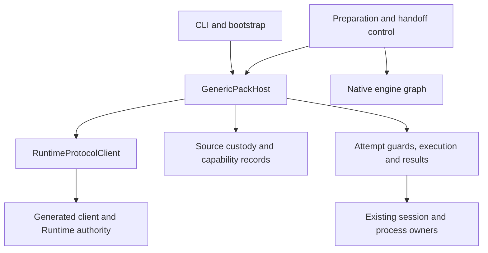

# Execution host map

[Plan](plan.md) · [Tasks](tasks.md) · [R14-P13-01](https://github.com/banodoco/astrid-dev/blob/5eeccba35565ac7ae12c0c94b4a46dcde785d782/releases/14/packets/R14-P13-01.md)

## Source and limits

This is HM1's read-only map for Release 15 extraction and Plan 55's resident-session work. It maps the packet's **fixed source**, not the moving release branch. No Agent source or test is changed by HM1. HM3 is a separate stop-path repair in `host_bootstrap.py` and is not folded into this map.

| Input | Exact identity |
| --- | --- |
| Agent snapshot | `fc391dea696ec5799db222799a34f9de6a69659b` (`release/14/main` when selected by the packet; also the starting `release/14/plan-13` head) |
| File | [astrid/core/execution/generic_host.py](https://github.com/banodoco/astrid-agent/blob/fc391dea696ec5799db222799a34f9de6a69659b/astrid/core/execution/generic_host.py) |
| File size | **18,784 lines** |
| Top-level definitions | **188: 159 functions and 29 classes** |
| File SHA-256 | `e3f8bec5525fb445f31b68d6a4a9fe9df0776356d8a8e4fe85d9f36257804337` |
| Packet / authority / Plan 55 task context | astrid-dev `5eeccba35565ac7ae12c0c94b4a46dcde785d782` |
| Documentation branch base | astrid-dev `f49111e279742f23d99fe70ef40b6be46a3de9c6`, target `release/14/plan-13` |

The definition inventory below assigns each top-level function or class to exactly one responsibility. A class counts once, including its body. The 99 `GenericPackHost` methods and the larger supporting classes receive a second, explicitly nested map; those rows do not increase the 188-definition total. Decorators and module initialization are described separately.

Callers and tests were identified by searches of the same Git commit, followed by reading the call sites. **Test reachability here is source evidence, not a coverage measurement or a claim that those tests pass.** No Agent tests were run for HM1. Method references, patches, source-string assertions and constructors have different evidential strength; the gap notes preserve that distinction.

After Plan 55 lands, redraw the map on the integrated release head before extraction. Later Windows diagnostics/cleanup changes on `release/14/main` do not silently change this source identity. The original `inputs.md` pre-main notes are historical; the packet's release-plan destination governs this work.

## Architectural boundaries

The code confirms the original six candidate areas, but they are too coarse to extract safely as six files. Source custody, execution guards, interactive child work, and activation/custody handoff have their own invariants. The result is fourteen responsibility groups; these are a map, not a requirement to create fourteen modules.

Runtime owns durable admission, attempts, leases, resource reservation and settlement. `RuntimeProtocolClient` translates host values into the generated client's operations. `GenericPackHost` coordinates discovery, preparation, the admitted attempt, output handling and cleanup. Existing process/session modules already implement custody and fencing. An extraction should retain these ownership relationships.



### Responsibility census

| ID | Responsibility | Top-level definitions |
| --- | --- | ---: |
| R01 | Startup observations | 1 |
| R02 | Runtime protocol and terminal evidence | 11 |
| R03 | Managed inputs and output identities | 9 |
| R04 | Managed execution adapters | 4 |
| R05 | Capabilities and readiness | 29 |
| R06 | Worker bindings, imports and network policy | 23 |
| R07 | Process ownership and cleanup | 10 |
| R08 | Execution contracts, lifetime and storage guards | 25 |
| R09 | Interactive review and discovery | 7 |
| R10 | Source custody and pack capture | 26 |
| R11 | Host coordination and persistent supervision | 8 |
| R12 | Local preparation and authenticated handoff | 21 |
| R13 | Native engine graph | 2 |
| R14 | Activation and CLI lifecycle | 12 |
| Total | One owner for every top-level definition | **188** |

## Responsibilities, state and existing tests

### R01 — Startup observations

The fixed startup-phase emitter writes bounded diagnostics and one service timing row per phase. Its public integration is the CLI plus the bootstrap module, which enables observation and calls the emitter. Preserve the sink checks and unchanged descriptor flags.

**Entry points and boundaries:** [`_emit_startup_phase` (99–133)](https://github.com/banodoco/astrid-agent/blob/fc391dea696ec5799db222799a34f9de6a69659b/astrid/core/execution/generic_host.py#L99).

**State and effects:** Rebinds `_STARTUP_TIMING_LAST` and mutates `_STARTUP_TIMING_SEEN`. The CLI and `host_bootstrap.ensure_pack_host` can enable `_STARTUP_OBSERVATION_ENABLED`. The start timestamp and allowed phase set are initialized at import.

**Existing tests that reach this responsibility:**

- [`tests/core/execution/test_windows_diagnostic_sinks.py::test_service_startup_timing_reaches_pipe_once_per_phase`](https://github.com/banodoco/astrid-agent/blob/fc391dea696ec5799db222799a34f9de6a69659b/tests/core/execution/test_windows_diagnostic_sinks.py#L74)
- [`tests/core/execution/test_generic_host_actions_v3.py::test_startup_phase_row_is_fixed_numeric_and_preserves_fd_flags`](https://github.com/banodoco/astrid-agent/blob/fc391dea696ec5799db222799a34f9de6a69659b/tests/core/execution/test_generic_host_actions_v3.py#L1041)

**Coverage limits / HM2 input:** Focused emitter tests exist. The complete import-to-service-start sequence is only exercised through startup/integration paths; a small emitter test does not certify startup progress.

### R02 — Runtime protocol and terminal evidence

The adapter authenticates the worker, retains per-attempt Runtime epochs, registers capabilities, claims work, renews leases, reads/uploads objects, admits children and publishes terminal results. Error helpers distinguish an authoritative rejection from uncertain publication; terminal requests are persisted for exact replay. It delegates HTTP, route paths and wire types to the generated client.

**Entry points and boundaries:** [`RuntimeProtocolClient` (5387–6259)](https://github.com/banodoco/astrid-agent/blob/fc391dea696ec5799db222799a34f9de6a69659b/astrid/core/execution/generic_host.py#L5387); [`HostError` (265–270)](https://github.com/banodoco/astrid-agent/blob/fc391dea696ec5799db222799a34f9de6a69659b/astrid/core/execution/generic_host.py#L265); [`HostLeaseLost` (273–276)](https://github.com/banodoco/astrid-agent/blob/fc391dea696ec5799db222799a34f9de6a69659b/astrid/core/execution/generic_host.py#L273); [`TerminalPublicationRejected` (297–298)](https://github.com/banodoco/astrid-agent/blob/fc391dea696ec5799db222799a34f9de6a69659b/astrid/core/execution/generic_host.py#L297); [`_terminal_publication_rejection` (309–335)](https://github.com/banodoco/astrid-agent/blob/fc391dea696ec5799db222799a34f9de6a69659b/astrid/core/execution/generic_host.py#L309); [`_persist_terminal_request` (338–348)](https://github.com/banodoco/astrid-agent/blob/fc391dea696ec5799db222799a34f9de6a69659b/astrid/core/execution/generic_host.py#L338).

**State and effects:** No module-state rebinding. Each client owns its generated transport, `_attempt_runtime_epochs`, worker/session identity, heartbeat sequence and lock. `fork_for_host_slot` creates private transport and attempt state. Keep these separate from process-wide custody and from the host’s handoff counters.

**Existing tests that reach this responsibility:**

- [`tests/core/execution/test_runtime_epoch_fence.py::test_claim_epoch_is_reused_and_not_replaced_after_runtime_restart`](https://github.com/banodoco/astrid-agent/blob/fc391dea696ec5799db222799a34f9de6a69659b/tests/core/execution/test_runtime_epoch_fence.py#L50)
- [`tests/core/execution/test_terminal_evidence_transport_f05.py::test_failure_lost_ack_uses_durable_readback_without_replaying`](https://github.com/banodoco/astrid-agent/blob/fc391dea696ec5799db222799a34f9de6a69659b/tests/core/execution/test_terminal_evidence_transport_f05.py#L110)
- [`tests/core/execution/test_terminal_publication_replay.py::test_host_transient_publication_replays_exact_wire`](https://github.com/banodoco/astrid-agent/blob/fc391dea696ec5799db222799a34f9de6a69659b/tests/core/execution/test_terminal_publication_replay.py#L68)

**Coverage limits / HM2 input:** Strong examples exist for fences and uncertain outcomes. Some small methods have no direct method reference in the static census; they are called by larger host/child tests. HM2 must trace those callers before labelling them untested. LS-7 changes this boundary.

### R03 — Managed inputs and output identities

Helpers derive confined staging names, validate managed assets, retain media type/filename identity, choose generation output ports and selectors, and bind named parent outputs. The actual I/O and settlement ordering remains in the host-method map below.

**Entry points and boundaries:** [`_managed_input_staging_name` (228–235)](https://github.com/banodoco/astrid-agent/blob/fc391dea696ec5799db222799a34f9de6a69659b/astrid/core/execution/generic_host.py#L228); [`_managed_asset_identity` (566–588)](https://github.com/banodoco/astrid-agent/blob/fc391dea696ec5799db222799a34f9de6a69659b/astrid/core/execution/generic_host.py#L566); [`_settlement_media_type` (646–677)](https://github.com/banodoco/astrid-agent/blob/fc391dea696ec5799db222799a34f9de6a69659b/astrid/core/execution/generic_host.py#L646); [`_generation_output_port` (711–755)](https://github.com/banodoco/astrid-agent/blob/fc391dea696ec5799db222799a34f9de6a69659b/astrid/core/execution/generic_host.py#L711); [`_bind_named_parent_output` (17349–17372)](https://github.com/banodoco/astrid-agent/blob/fc391dea696ec5799db222799a34f9de6a69659b/astrid/core/execution/generic_host.py#L17349).

**State and effects:** Reads immutable lookup sets/maps and passed descriptors; no module-state writes. Filesystem/CAS effects belong to the host and client call sites, not these naming helpers.

**Existing tests that reach this responsibility:**

- [`tests/core/test_path_utils.py::test_managed_input_staging_names_never_include_user_filename`](https://github.com/banodoco/astrid-agent/blob/fc391dea696ec5799db222799a34f9de6a69659b/tests/core/test_path_utils.py#L29)
- [`tests/sdk/test_generation_publication_consumer.py::test_named_parent_output_uses_admitted_final_selector`](https://github.com/banodoco/astrid-agent/blob/fc391dea696ec5799db222799a34f9de6a69659b/tests/sdk/test_generation_publication_consumer.py#L413)

**Coverage limits / HM2 input:** Naming/binding helpers have direct tests. End-to-end byte custody, partial-output publication and thumbnails require the host/Runtime tests listed under R11. LS-6 spans both groups.

### R04 — Managed execution adapters

Task, attached-local-server and Wan child adapters expose observation, fencing, cancellation and release to `ManagedToolSession`. Wan owns a persistent child and framed pipe exchange; attached cleanup returns a scoped refusal instead of taking another owner’s jobs. These are existing session mechanisms for LS-8 to compose with.

**Entry points and boundaries:** [`_ManagedTaskAdapter` (818–855)](https://github.com/banodoco/astrid-agent/blob/fc391dea696ec5799db222799a34f9de6a69659b/astrid/core/execution/generic_host.py#L818); [`_ManagedLocalServerTaskAdapter` (858–891)](https://github.com/banodoco/astrid-agent/blob/fc391dea696ec5799db222799a34f9de6a69659b/astrid/core/execution/generic_host.py#L858); [`_ManagedWanChildAdapter` (915–1225)](https://github.com/banodoco/astrid-agent/blob/fc391dea696ec5799db222799a34f9de6a69659b/astrid/core/execution/generic_host.py#L915); [`_attached_cleanup_refusal` (894–910)](https://github.com/banodoco/astrid-agent/blob/fc391dea696ec5799db222799a34f9de6a69659b/astrid/core/execution/generic_host.py#L894).

**State and effects:** No module-level reads/writes beyond functions/types. Each adapter retains its task/session/child and cleanup evidence. The host owns session admission and lifetime; these adapters do not acquire Runtime admission authority.

**Existing tests that reach this responsibility:**

- [`tests/core/generation/test_attached_cleanup_refusal.py::test_attached_cleanup_sends_only_scoped_requests`](https://github.com/banodoco/astrid-agent/blob/fc391dea696ec5799db222799a34f9de6a69659b/tests/core/generation/test_attached_cleanup_refusal.py#L191)
- [`tests/core/execution/test_pipe_io.py::test_wan_partial_frames_survive_observation_timeout_and_coalesced_frames`](https://github.com/banodoco/astrid-agent/blob/fc391dea696ec5799db222799a34f9de6a69659b/tests/core/execution/test_pipe_io.py#L266)
- [`tests/core/execution/test_pipe_io.py::test_wan_census_failure_retains_custody_but_joins_pipe_workers`](https://github.com/banodoco/astrid-agent/blob/fc391dea696ec5799db222799a34f9de6a69659b/tests/core/execution/test_pipe_io.py#L379)

**Coverage limits / HM2 input:** Adapter and pipe tests exist. A future general resident pack action is not already proven by Wan or attached-engine tests; LS-8 needs its own two-job/fence/source-change proof while preserving these tests.

### R05 — Capabilities and readiness

AdapterSpec/AdapterRegistry and CapabilityRecord describe supported executor families, resource keys, storage facts and manifest entries. Helpers normalize readiness facts, gate Remotion, detect withdrawn/quarantined definitions and present skipped-component diagnostics. Discovery, admission and registration still live on GenericPackHost.

**Entry points and boundaries:** [`AdapterSpec` (1705–1713)](https://github.com/banodoco/astrid-agent/blob/fc391dea696ec5799db222799a34f9de6a69659b/astrid/core/execution/generic_host.py#L1705); [`AdapterRegistry` (1727–1799)](https://github.com/banodoco/astrid-agent/blob/fc391dea696ec5799db222799a34f9de6a69659b/astrid/core/execution/generic_host.py#L1727); [`CapabilityRecord` (5232–5327)](https://github.com/banodoco/astrid-agent/blob/fc391dea696ec5799db222799a34f9de6a69659b/astrid/core/execution/generic_host.py#L5232); [`HostRegistrationError` (1235–1251)](https://github.com/banodoco/astrid-agent/blob/fc391dea696ec5799db222799a34f9de6a69659b/astrid/core/execution/generic_host.py#L1235); [`component_load_failures` (6297–6335)](https://github.com/banodoco/astrid-agent/blob/fc391dea696ec5799db222799a34f9de6a69659b/astrid/core/execution/generic_host.py#L6297); [`executor_skip_section` (6338–6344)](https://github.com/banodoco/astrid-agent/blob/fc391dea696ec5799db222799a34f9de6a69659b/astrid/core/execution/generic_host.py#L6338).

**State and effects:** Reads capability/fact limits and withdrawn-disposition sets; no module-state writes. Capability records contain their own preflight/readiness and definition metadata. The host replaces/copies records around registration and slot refresh.

**Existing tests that reach this responsibility:**

- [`tests/packs/test_executor_admission.py::test_discovery_skips_the_bad_executor_and_names_it_in_doctor`](https://github.com/banodoco/astrid-agent/blob/fc391dea696ec5799db222799a34f9de6a69659b/tests/packs/test_executor_admission.py#L86)
- [`tests/packs/test_executor_admission.py::test_shipped_packs_have_no_skipped_executors_or_orchestrators`](https://github.com/banodoco/astrid-agent/blob/fc391dea696ec5799db222799a34f9de6a69659b/tests/packs/test_executor_admission.py#L122)

**Coverage limits / HM2 input:** `component_load_failures` has no direct test-symbol reference in the census; `executor_skip_section` calls it and has named tests. Treat its malformed/quarantined-input detail as thin until those assertions are traced, not as proof of no coverage.

### R06 — Worker bindings, imports and network policy

Bind host-owned command values/output ports, construct verified VibeComfy identity, select interpreter/import roots, resolve explicit credentials, and assemble restricted network startup. `_NetworkBrokerContext` owns the broker stop handle. The selected-source and network authority must travel together into either one-shot or future resident execution.

**Entry points and boundaries:** [`_bind_host_owned_command_outputs` (1420–1457)](https://github.com/banodoco/astrid-agent/blob/fc391dea696ec5799db222799a34f9de6a69659b/astrid/core/execution/generic_host.py#L1420); [`_bind_host_owned_command_values` (1460–1528)](https://github.com/banodoco/astrid-agent/blob/fc391dea696ec5799db222799a34f9de6a69659b/astrid/core/execution/generic_host.py#L1460); [`_prepare_vibecomfy_execution_identity` (1531–1591)](https://github.com/banodoco/astrid-agent/blob/fc391dea696ec5799db222799a34f9de6a69659b/astrid/core/execution/generic_host.py#L1531); [`_launch_worker_probe_environments` (2125–2265)](https://github.com/banodoco/astrid-agent/blob/fc391dea696ec5799db222799a34f9de6a69659b/astrid/core/execution/generic_host.py#L2125); [`_captured_worker_argv` (2487–2502)](https://github.com/banodoco/astrid-agent/blob/fc391dea696ec5799db222799a34f9de6a69659b/astrid/core/execution/generic_host.py#L2487); [`_network_startup_argv` (2452–2484)](https://github.com/banodoco/astrid-agent/blob/fc391dea696ec5799db222799a34f9de6a69659b/astrid/core/execution/generic_host.py#L2452); [`_network_sandbox_argv` (2505–2537)](https://github.com/banodoco/astrid-agent/blob/fc391dea696ec5799db222799a34f9de6a69659b/astrid/core/execution/generic_host.py#L2505).

**State and effects:** No rebinding of this module’s named state. `_install_host_vibecomfy_import_root` changes interpreter import state (`sys.path`/modules); environment construction reads explicit and ambient inputs. Startup strings are executable boundary data, not passive configuration.

**Existing tests that reach this responsibility:**

- [`tests/core/execution/test_generic_host_actions_v3.py::test_host_identity_uses_shared_canonical_bundle_staging`](https://github.com/banodoco/astrid-agent/blob/fc391dea696ec5799db222799a34f9de6a69659b/tests/core/execution/test_generic_host_actions_v3.py#L610)
- [`tests/core/execution/test_generic_host_child_bridge_d18.py::test_network_startup_preserves_utf8_pair_before_isolation_flags`](https://github.com/banodoco/astrid-agent/blob/fc391dea696ec5799db222799a34f9de6a69659b/tests/core/execution/test_generic_host_child_bridge_d18.py#L2464)

**Coverage limits / HM2 input:** Bindings and command/environment boundaries have focused tests, with installed/source and provider-specific compositions elsewhere. LS-8 must preserve the current source fences and restricted environment rather than bypassing them on a warm call.

### R07 — Process ownership and cleanup

Helpers clean ephemeral attempts, check retained process identity, confine command cwd and observe/retire owned human-review sessions. Cleanup uncertainty is an explicit outcome. Kernel/process custody is delegated to existing process_group, task_scope and custody_broker code.

**Entry points and boundaries:** [`CommandCleanupUnresolved` (545–550)](https://github.com/banodoco/astrid-agent/blob/fc391dea696ec5799db222799a34f9de6a69659b/astrid/core/execution/generic_host.py#L545); [`HostCancelled` (559–560)](https://github.com/banodoco/astrid-agent/blob/fc391dea696ec5799db222799a34f9de6a69659b/astrid/core/execution/generic_host.py#L559); [`_cleanup_ephemeral_attempt` (788–804)](https://github.com/banodoco/astrid-agent/blob/fc391dea696ec5799db222799a34f9de6a69659b/astrid/core/execution/generic_host.py#L788); [`_terminate_process_group` (1837–1854)](https://github.com/banodoco/astrid-agent/blob/fc391dea696ec5799db222799a34f9de6a69659b/astrid/core/execution/generic_host.py#L1837); [`_observe_owned_review_session` (1861–1905)](https://github.com/banodoco/astrid-agent/blob/fc391dea696ec5799db222799a34f9de6a69659b/astrid/core/execution/generic_host.py#L1861); [`_retire_owned_review_session` (1908–1922)](https://github.com/banodoco/astrid-agent/blob/fc391dea696ec5799db222799a34f9de6a69659b/astrid/core/execution/generic_host.py#L1908); [`_confined_cwd` (1925–1947)](https://github.com/banodoco/astrid-agent/blob/fc391dea696ec5799db222799a34f9de6a69659b/astrid/core/execution/generic_host.py#L1925).

**State and effects:** Reads the review-session marker name; no module-state writes. Effects include process observation/termination and attempt or review-marker cleanup. Preserve the retained owner/nonce checks; a pathname or PID alone is not a replacement capability.

**Existing tests that reach this responsibility:**

- [`tests/core/execution/test_render_scope_cleanup.py::test_unresolved_command_scope_retains_attempt_and_records_receipt`](https://github.com/banodoco/astrid-agent/blob/fc391dea696ec5799db222799a34f9de6a69659b/tests/core/execution/test_render_scope_cleanup.py#L70)
- [`tests/core/execution/test_generic_host_actions_v3.py::test_review_descriptor_cannot_adopt_foreign_process_or_receiver`](https://github.com/banodoco/astrid-agent/blob/fc391dea696ec5799db222799a34f9de6a69659b/tests/core/execution/test_generic_host_actions_v3.py#L786)

**Coverage limits / HM2 input:** Native custody success requires the platform-specific proofs owned by Plan 38. Pure/mocked tests here do not prove a Linux pidfd, macOS audit token or Windows Job path. HM1 does not edit or relabel those tests.

### R08 — Execution contracts, lifetime and storage guards

Validate the immutable execution request against the claimed task, verified target binding and Runtime session; enforce fixed request scope, queue/execution/collection budgets, review-accounting intervals, live disk reserve and admitted output/scratch limits. Claim-result helpers identify task-specific head-of-line refusal without creating scheduling authority.

**Entry points and boundaries:** [`_execution_contract` (2831–2979)](https://github.com/banodoco/astrid-agent/blob/fc391dea696ec5799db222799a34f9de6a69659b/astrid/core/execution/generic_host.py#L2831); [`_assert_verified_placement_binding` (2793–2828)](https://github.com/banodoco/astrid-agent/blob/fc391dea696ec5799db222799a34f9de6a69659b/astrid/core/execution/generic_host.py#L2793); [`_AttemptLifetime` (3038–3111)](https://github.com/banodoco/astrid-agent/blob/fc391dea696ec5799db222799a34f9de6a69659b/astrid/core/execution/generic_host.py#L3038); [`_ReviewIntervalAccounting` (2983–3034)](https://github.com/banodoco/astrid-agent/blob/fc391dea696ec5799db222799a34f9de6a69659b/astrid/core/execution/generic_host.py#L2983); [`_assert_live_storage_envelope` (4540–4601)](https://github.com/banodoco/astrid-agent/blob/fc391dea696ec5799db222799a34f9de6a69659b/astrid/core/execution/generic_host.py#L4540); [`_task_storage_envelope` (4604–4671)](https://github.com/banodoco/astrid-agent/blob/fc391dea696ec5799db222799a34f9de6a69659b/astrid/core/execution/generic_host.py#L4604); [`_claim_blocked_capability` (4479–4488)](https://github.com/banodoco/astrid-agent/blob/fc391dea696ec5799db222799a34f9de6a69659b/astrid/core/execution/generic_host.py#L4479).

**State and effects:** No module-state writes. Lifetime/accounting objects are per attempt; storage measurements read the attempt/output trees. `GenericPackHost.execution_policy` and its shared evidence budget remain explicit inputs, including when slots share them.

**Existing tests that reach this responsibility:**

- [`tests/core/execution/test_generic_host_contract.py::test_contract_runtime_deadline_cancels_slow_child`](https://github.com/banodoco/astrid-agent/blob/fc391dea696ec5799db222799a34f9de6a69659b/tests/core/execution/test_generic_host_contract.py#L286)
- [`tests/core/execution/test_generic_host_contract.py::test_contract_collection_deadline_fences_settlement`](https://github.com/banodoco/astrid-agent/blob/fc391dea696ec5799db222799a34f9de6a69659b/tests/core/execution/test_generic_host_contract.py#L269)
- [`tests/core/execution/test_render_storage.py::test_non_render_pack_retains_its_bounded_storage_contract`](https://github.com/banodoco/astrid-agent/blob/fc391dea696ec5799db222799a34f9de6a69659b/tests/core/execution/test_render_storage.py#L92)

**Coverage limits / HM2 input:** Focused refusal/deadline/storage tests exist. Do not infer native lifecycle correctness from these pure contract cases. Any extraction of the lifetime object must keep the run_task observer and completion lock together until their shared tests prove otherwise.

### R09 — Interactive review and discovery

Create parent-fenced authority for interactive/video/training review and discovery; collect bounded child metadata, prepare managed objects and submit prepared children through the existing child bridge. Training media inspection validates archive/descriptor limits and keeps its cache inside the authority closure.

**Entry points and boundaries:** [`_interactive_review_authority` (3121–3347)](https://github.com/banodoco/astrid-agent/blob/fc391dea696ec5799db222799a34f9de6a69659b/astrid/core/execution/generic_host.py#L3121); [`_DiscoveryCollection` (3350–3806)](https://github.com/banodoco/astrid-agent/blob/fc391dea696ec5799db222799a34f9de6a69659b/astrid/core/execution/generic_host.py#L3350); [`_iteration_video_discovery` (3809–3941)](https://github.com/banodoco/astrid-agent/blob/fc391dea696ec5799db222799a34f9de6a69659b/astrid/core/execution/generic_host.py#L3809); [`_training_review_media_scope` (3949–4161)](https://github.com/banodoco/astrid-agent/blob/fc391dea696ec5799db222799a34f9de6a69659b/astrid/core/execution/generic_host.py#L3949); [`_training_review_authority` (4164–4364)](https://github.com/banodoco/astrid-agent/blob/fc391dea696ec5799db222799a34f9de6a69659b/astrid/core/execution/generic_host.py#L4164); [`_prepare_review_resume_input` (5330–5384)](https://github.com/banodoco/astrid-agent/blob/fc391dea696ec5799db222799a34f9de6a69659b/astrid/core/execution/generic_host.py#L5330).

**State and effects:** Reads training archive/cache limits; no module-state writes. `_DiscoveryCollection` and returned closures retain parent authority, bridge handles, prepared objects, cache/accounting and stop state. Their lifetimes are attached to the admitted parent, not a new scheduler.

**Existing tests that reach this responsibility:**

- [`tests/core/execution/test_generic_host_child_bridge_d18.py::test_f05_media_immutable_closure_and_live_authority_cache`](https://github.com/banodoco/astrid-agent/blob/fc391dea696ec5799db222799a34f9de6a69659b/tests/core/execution/test_generic_host_child_bridge_d18.py#L4710)
- [`tests/core/execution/test_generic_host_child_bridge_d18.py::test_f05_media_cache_identity_change_and_closed_bridge_revoke`](https://github.com/banodoco/astrid-agent/blob/fc391dea696ec5799db222799a34f9de6a69659b/tests/core/execution/test_generic_host_child_bridge_d18.py#L4855)
- [`tests/core/execution/test_generic_host_child_bridge_d18.py::test_f05_media_limits_are_independent`](https://github.com/banodoco/astrid-agent/blob/fc391dea696ec5799db222799a34f9de6a69659b/tests/core/execution/test_generic_host_child_bridge_d18.py#L4798)

**Coverage limits / HM2 input:** Existing coverage is concentrated in a large child-bridge test file and its fixtures. A direct constructor reference alone does not pin every DiscoveryCollection method. HM2 should name collection/stop/result lifecycle cases explicitly before this responsibility moves.

### R10 — Source custody and pack capture

Consume Runtime-retained external sources, verify grants and capture immutable pack generations; compute source/dependency/provenance identities; relocate captured definitions and verify action admission before execution. Public digest functions and imported re-exports are already used across SDK/worker/installer boundaries.

**Entry points and boundaries:** [`_RuntimeSourceCustody` (351–531)](https://github.com/banodoco/astrid-agent/blob/fc391dea696ec5799db222799a34f9de6a69659b/astrid/core/execution/generic_host.py#L351); [`_consume_runtime_external_sources` (537–542)](https://github.com/banodoco/astrid-agent/blob/fc391dea696ec5799db222799a34f9de6a69659b/astrid/core/execution/generic_host.py#L537); [`source_checkout_digest` (4674–4684)](https://github.com/banodoco/astrid-agent/blob/fc391dea696ec5799db222799a34f9de6a69659b/astrid/core/execution/generic_host.py#L4674); [`process_birth_identity` (4687–4689)](https://github.com/banodoco/astrid-agent/blob/fc391dea696ec5799db222799a34f9de6a69659b/astrid/core/execution/generic_host.py#L4687); [`_portable_pack_capture` (4818–4887)](https://github.com/banodoco/astrid-agent/blob/fc391dea696ec5799db222799a34f9de6a69659b/astrid/core/execution/generic_host.py#L4818); [`_selected_pack_capture` (4937–4983)](https://github.com/banodoco/astrid-agent/blob/fc391dea696ec5799db222799a34f9de6a69659b/astrid/core/execution/generic_host.py#L4937); [`_verify_action_admission` (5083–5113)](https://github.com/banodoco/astrid-agent/blob/fc391dea696ec5799db222799a34f9de6a69659b/astrid/core/execution/generic_host.py#L5083); [`_verify_admitted_source` (5117–5142)](https://github.com/banodoco/astrid-agent/blob/fc391dea696ec5799db222799a34f9de6a69659b/astrid/core/execution/generic_host.py#L5117).

**State and effects:** `_consume_runtime_external_sources` installs `_runtime_external_sources` once. The host selects and verifies against that retained object; the CLI binds its Runtime identity. `_standalone_pack_capture` is selected at import; `_UNSET_PACK_GENERATION` distinguishes missing selection. Preserve ownership of open descriptors/captures, not merely digest strings.

**Existing tests that reach this responsibility:**

- [`tests/core/execution/test_runtime_source_custody_d40.py::test_mutation_before_discovery_or_selection_fails_closed`](https://github.com/banodoco/astrid-agent/blob/fc391dea696ec5799db222799a34f9de6a69659b/tests/core/execution/test_runtime_source_custody_d40.py#L139)
- [`tests/core/execution/test_runtime_source_custody_d40.py::test_production_python_action_uses_private_descriptor`](https://github.com/banodoco/astrid-agent/blob/fc391dea696ec5799db222799a34f9de6a69659b/tests/core/execution/test_runtime_source_custody_d40.py#L217)
- [`tests/core/execution/test_runtime_source_custody_d40.py::test_wrong_source_root_cannot_fall_back_to_live_execution`](https://github.com/banodoco/astrid-agent/blob/fc391dea696ec5799db222799a34f9de6a69659b/tests/core/execution/test_runtime_source_custody_d40.py#L283)

**Coverage limits / HM2 input:** Custody and capture paths have direct/indirect tests. The Runtime-provided handle’s construction is intentionally reached through `_consume_runtime_external_sources`, so absence of direct `_RuntimeSourceCustody()` syntax is not absence of coverage. Import cycles with worker/runner/pack definitions make this a coupled boundary.

### R11 — Host coordination and persistent supervision

GenericPackHost is the composition root: 99 methods, 8,341 lines. It creates per-slot session owners; discovers, preflights and registers capabilities; prepares and executes one admitted attempt; publishes/recovers its terminal outcome; coordinates claims, cancellation, handoff and shutdown. Related top-level helpers publish occupancy, capture/redact task streams, attest startup targets and align local-machine work.

**Entry points and boundaries:** [`GenericPackHost` (6688–15028)](https://github.com/banodoco/astrid-agent/blob/fc391dea696ec5799db222799a34f9de6a69659b/astrid/core/execution/generic_host.py#L6688); [`_TaskOutputCapture` (6475–6651)](https://github.com/banodoco/astrid-agent/blob/fc391dea696ec5799db222799a34f9de6a69659b/astrid/core/execution/generic_host.py#L6475); [`_publish_busy` (6452–6472)](https://github.com/banodoco/astrid-agent/blob/fc391dea696ec5799db222799a34f9de6a69659b/astrid/core/execution/generic_host.py#L6452); [`_startup_identity_attestation` (6377–6444)](https://github.com/banodoco/astrid-agent/blob/fc391dea696ec5799db222799a34f9de6a69659b/astrid/core/execution/generic_host.py#L6377); [`_configured_claim_target` (6347–6374)](https://github.com/banodoco/astrid-agent/blob/fc391dea696ec5799db222799a34f9de6a69659b/astrid/core/execution/generic_host.py#L6347); [`_local_machine` (6654–6663)](https://github.com/banodoco/astrid-agent/blob/fc391dea696ec5799db222799a34f9de6a69659b/astrid/core/execution/generic_host.py#L6654).

**State and effects:** `_publish_busy` changes `_busy_active` under `_busy_lock` and publishes an occupancy marker. The host reads many module policy/size constants and mutates retained source-custody state via its owner. Most mutable state is on the host, slot or per-attempt closure; the nested map below identifies the ownership boundaries.

**Existing tests that reach this responsibility:**

- [`tests/core/execution/test_generic_host_claim_loop.py::test_capacity_and_finite_claim_allowance_isolate_session_and_attempt_owners`](https://github.com/banodoco/astrid-agent/blob/fc391dea696ec5799db222799a34f9de6a69659b/tests/core/execution/test_generic_host_claim_loop.py#L159)
- [`tests/core/execution/test_generic_host_claim_loop.py::test_shutdown_fences_each_slot_and_cleans_only_its_owned_processes`](https://github.com/banodoco/astrid-agent/blob/fc391dea696ec5799db222799a34f9de6a69659b/tests/core/execution/test_generic_host_claim_loop.py#L247)
- [`tests/core/execution/test_generic_host_claim_loop.py::test_runtime_slot_fork_does_not_share_transport_or_attempt_heartbeat_state`](https://github.com/banodoco/astrid-agent/blob/fc391dea696ec5799db222799a34f9de6a69659b/tests/core/execution/test_generic_host_claim_loop.py#L401)

**Coverage limits / HM2 input:** Many focused tests reach this class, including terminal replay, output logs, thumbnails, storage, warm holds and protected heartbeat tests. A count of host constructors is not proof of all methods. The monolithic run_task/_run_task_impl closure boundary is the main characterization risk; LS-6/7/8 overlap different slices of it.

### R12 — Local preparation and authenticated handoff

Validate versioned local profiles and private control frames; prepare a graph without claiming work; bind activation evidence; maintain the handoff journal and exact replay state; pause/export/adopt/rebind/resume/finalize the existing host; retain cleanup obligations on abort. Preparation is distinct from activation, task admission and registration.

**Entry points and boundaries:** [`LocalExecutionPreparation` (15538–17297)](https://github.com/banodoco/astrid-agent/blob/fc391dea696ec5799db222799a34f9de6a69659b/astrid/core/execution/generic_host.py#L15538); [`_validate_local_engine_profile` (15492–15531)](https://github.com/banodoco/astrid-agent/blob/fc391dea696ec5799db222799a34f9de6a69659b/astrid/core/execution/generic_host.py#L15492); [`_handoff_live_runtime_binding` (15177–15232)](https://github.com/banodoco/astrid-agent/blob/fc391dea696ec5799db222799a34f9de6a69659b/astrid/core/execution/generic_host.py#L15177); [`_handoff_registered_state` (15235–15294)](https://github.com/banodoco/astrid-agent/blob/fc391dea696ec5799db222799a34f9de6a69659b/astrid/core/execution/generic_host.py#L15235); [`_handoff_journal_entry` (15426–15435)](https://github.com/banodoco/astrid-agent/blob/fc391dea696ec5799db222799a34f9de6a69659b/astrid/core/execution/generic_host.py#L15426).

**State and effects:** Reads version/schema/size/role constants; no module-level writes. The preparation object owns locks/events, graph/result/error, activation and producer bindings, original host pointer, journal descriptor, phase, cached replies and abort chains. Handoff operates the host’s existing claim gate and counters.

**Existing tests that reach this responsibility:**

- [`tests/test_generic_host.py::test_local_preparation_replay_never_launches_twice_and_is_not_activation`](https://github.com/banodoco/astrid-agent/blob/fc391dea696ec5799db222799a34f9de6a69659b/tests/test_generic_host.py#L3432)
- [`tests/core/execution/test_generic_host_handoff.py::test_pause_serializes_with_real_claim_rpc_and_settlement`](https://github.com/banodoco/astrid-agent/blob/fc391dea696ec5799db222799a34f9de6a69659b/tests/core/execution/test_generic_host_handoff.py#L216)
- [`tests/core/execution/test_generic_host_verified_preparation_gr03.py::test_live_retained_authority_is_rechecked_before_preparation`](https://github.com/banodoco/astrid-agent/blob/fc391dea696ec5799db222799a34f9de6a69659b/tests/core/execution/test_generic_host_verified_preparation_gr03.py#L318)

**Coverage limits / HM2 input:** Replay/authority/cleanup tests exist, but native host-control acceptance intersects Plan 38. Keep preparation/handoff extraction separate from LS-8’s pack-session extension; they have different owners and authority inputs.

### R13 — Native engine graph

Prepare and retain the native engine/listener roles, bind control peers, observe selected-source facts, report custody evidence, and abort through retained role ownership. `_retain_unresolved_owner` keeps uncertain cleanup owned instead of converting it into successful release.

**Entry points and boundaries:** [`_NativeEngineGraph` (17384–17797)](https://github.com/banodoco/astrid-agent/blob/fc391dea696ec5799db222799a34f9de6a69659b/astrid/core/execution/generic_host.py#L17384); [`_retain_unresolved_owner` (17800–17807)](https://github.com/banodoco/astrid-agent/blob/fc391dea696ec5799db222799a34f9de6a69659b/astrid/core/execution/generic_host.py#L17800).

**State and effects:** No direct module-state reads/writes. The graph owns role/process handles, listener/control threads and retained observations; effects use imported custody/process-control implementations.

**Existing tests that reach this responsibility:**

- [`tests/core/execution/test_generic_host_actions_v3.py::test_native_engine_launch_uses_spawn_tree_with_bound_custody_configuration`](https://github.com/banodoco/astrid-agent/blob/fc391dea696ec5799db222799a34f9de6a69659b/tests/core/execution/test_generic_host_actions_v3.py#L1747)
- [`tests/test_generic_host.py::test_engine_peer_capture_rejects_foreign_or_unreleased_peer`](https://github.com/banodoco/astrid-agent/blob/fc391dea696ec5799db222799a34f9de6a69659b/tests/test_generic_host.py#L4006)
- [`tests/test_generic_host.py::test_owner_retention_retries_bounded_abort_until_positive_cleanup`](https://github.com/banodoco/astrid-agent/blob/fc391dea696ec5799db222799a34f9de6a69659b/tests/test_generic_host.py#L4020)

**Coverage limits / HM2 input:** Native proof is platform-dependent and remains Plan 38-owned. Static graph construction and mocked cleanup are only part of the evidence. Do not treat the prepared-worker follow-up as dead code; Plan 14’s reachability decision is still required.

### R14 — Activation and CLI lifecycle

Compose the boot manifest and ready marker, exchange bounded private activation frames/owner receipts, wait for the enabled credential, wire shutdown on signals/stdin EOF, and enter run or the opt-in JSONL supervisor. Module execution also owns Windows main-thread NumPy preload and service-entry dispatch.

**Entry points and boundaries:** [`_compose_cli_boot_manifest` (15031–15055)](https://github.com/banodoco/astrid-agent/blob/fc391dea696ec5799db222799a34f9de6a69659b/astrid/core/execution/generic_host.py#L15031); [`_write_ready_marker` (15058–15072)](https://github.com/banodoco/astrid-agent/blob/fc391dea696ec5799db222799a34f9de6a69659b/astrid/core/execution/generic_host.py#L15058); [`_await_worker_activation` (17841–17957)](https://github.com/banodoco/astrid-agent/blob/fc391dea696ec5799db222799a34f9de6a69659b/astrid/core/execution/generic_host.py#L17841); [`_await_worker_activation_socket` (17960–18021)](https://github.com/banodoco/astrid-agent/blob/fc391dea696ec5799db222799a34f9de6a69659b/astrid/core/execution/generic_host.py#L17960); [`_await_enabled_runtime_credential` (18024–18039)](https://github.com/banodoco/astrid-agent/blob/fc391dea696ec5799db222799a34f9de6a69659b/astrid/core/execution/generic_host.py#L18024); [`_ManagedStdinShutdown` (18068–18130)](https://github.com/banodoco/astrid-agent/blob/fc391dea696ec5799db222799a34f9de6a69659b/astrid/core/execution/generic_host.py#L18068); [`_cli` (18148–18159)](https://github.com/banodoco/astrid-agent/blob/fc391dea696ec5799db222799a34f9de6a69659b/astrid/core/execution/generic_host.py#L18148); [`_cli_impl` (18162–18753)](https://github.com/banodoco/astrid-agent/blob/fc391dea696ec5799db222799a34f9de6a69659b/astrid/core/execution/generic_host.py#L18162).

**State and effects:** The CLI enables startup observation and binds `_runtime_external_sources`. It sets process environment, installs signal handlers and creates lifecycle owners. At module execution Windows sets OPENBLAS_NUM_THREADS if absent and attempts NumPy preload; service entry aliases `sys.modules` before calling `astrid.services.main`.

**Existing tests that reach this responsibility:**

- [`tests/core/execution/test_generic_host_activation.py::test_local_receiver_waits_for_owner_receipt_before_final_ack`](https://github.com/banodoco/astrid-agent/blob/fc391dea696ec5799db222799a34f9de6a69659b/tests/core/execution/test_generic_host_activation.py#L50)
- [`tests/core/execution/test_generic_host_activation.py::test_parked_host_times_out_without_reading_a_credential`](https://github.com/banodoco/astrid-agent/blob/fc391dea696ec5799db222799a34f9de6a69659b/tests/core/execution/test_generic_host_activation.py#L381)
- [`tests/core/execution/test_task_scope.py::test_managed_stdin_eof_waits_for_host_task_tree_cleanup`](https://github.com/banodoco/astrid-agent/blob/fc391dea696ec5799db222799a34f9de6a69659b/tests/core/execution/test_task_scope.py#L157)

**Coverage limits / HM2 input:** Activation and EOF tests exist. Real activation acceptance is Plan 38-owned; module-import side effects and complete signal/service entry remain broader startup characterisation work. No new native-platform proof is claimed here.

## Shared module state

The table lists references to names assigned at module scope, found inside the owned definitions (including methods and nested closures). It excludes imports, builtins and ordinary local variables. These are source-level reads; mutable object effects are described above. `none` means no reference to a module-assigned name, not that the code has no external effects.

| Responsibility | Module-assigned names read | Rebinding or mutable module object effects |
| --- | --- | --- |
| R01 | `_STARTUP_OBSERVATION_ENABLED`, `_STARTUP_OBSERVATION_PHASES`, `_STARTUP_OBSERVATION_STARTED`, `_STARTUP_TIMING_LAST`, `_STARTUP_TIMING_SEEN` | `_STARTUP_TIMING_LAST` assignment; `_STARTUP_TIMING_SEEN.add` |
| R02 | `_DEFAULT_EXECUTION_POLICY` | none |
| R03 | `_MANAGED_ASSET_LOCATOR_KEYS`, `_RUNTIME_OUTPUT_NAMESPACES`, `_SUFFIX_MEDIA_TYPES` | none |
| R04 | none | none |
| R05 | `_EXECUTION_FACT_EXACT_KEYS`, `_EXECUTION_FACT_MINIMUM_KEYS`, `_MAX_EXECUTION_FACT_BYTES`, `_WITHDRAWN_DISPOSITIONS` | none |
| R06 | `_HOST_OWNED_ENVELOPE_PORTS`, `_STRICT_NETWORK_HOOK_SOURCE`, `_STRICT_NETWORK_STARTUP`, `_TYPED_FAMILIES` | none |
| R07 | `_REVIEW_SESSION_NAME` | none |
| R08 | `_RENDERER_WORKSPACE_MARKERS`, `_STORAGE_DIAGNOSTIC_PATH_SAMPLE_LIMIT`, `_TASK_OUTPUT_DIAGNOSTIC_NAMES`, `_TASK_SPECIFIC_WAITING_REASONS` | none |
| R09 | `_TRAINING_REVIEW_ARCHIVE_BYTES`, `_TRAINING_REVIEW_ARCHIVE_ENTRIES`, `_TRAINING_REVIEW_SCOPE_CACHE_ENTRIES` | none |
| R10 | `_UNSET_PACK_GENERATION`, `_runtime_external_sources`, `_standalone_pack_capture` | `_runtime_external_sources` installation; its retained handles/grants remain object state |
| R11 | `INLINE_OUTPUT_MAX_BYTES`, `INLINE_SETTLEMENT_BUDGET_BYTES`, `REMOTION_GATE_DESCRIPTION`, `RUNTIME_OBJECT_LIMIT_BYTES`, `_CLAIM_HEAD_OF_LINE_SKIPS`, `_DEFAULT_EXECUTION_POLICY`, `_EXECUTOR_REFRESH_SECONDS`, `_HOST_OWNED_ENVELOPE_PORTS`, `_LEASE_POLL_SECONDS`, `_LIVE_GUARD_INTERVAL_SECONDS`, `_LOGGER`, `_OPTIONAL_EXTERNAL_MATRIX_PREFIXES`, `_REVIEW_LAUNCH_NONCE_ENV`, `_SETTLEMENT_OUTPUT_METADATA_FIELDS`, `_STRICT_NETWORK_HOOK_SOURCE`, `_TASK_OUTPUT_DIAGNOSTIC_NAMES`, `_TASK_OUTPUT_METADATA_NAME`, `_TASK_OUTPUT_TAIL_BYTES`, `_TASK_OUTPUT_TAIL_NAMES`, `_TERMINAL_RECONCILE_POLL_SECONDS`, `_TERMINAL_RECOVERY_MAX_ATTEMPTS`, `_WARM_SESSION_ADAPTERS`, `_busy_active`, `_busy_lock`, `_runtime_external_sources` | `_busy_active` under `_busy_lock`; selection on `_runtime_external_sources` |
| R12 | `ADMISSION_CLEANUP_VERSION`, `CURRENT_ROLES_VERSION`, `_ACTIVATION_DIGEST`, `_ACTIVATION_VERSION`, `_HANDOFF_BINDING_FIELDS`, `_HANDOFF_COMMAND_PAYLOADS`, `_HANDOFF_ROLE_NAMES`, `_HANDOFF_VERSION`, `_LOCAL_PREPARATION_VERSION`, `_LOCAL_PROFILE_REQUIRED`, `_PRODUCER_FRAME_LIMIT`, `_PRODUCER_PREPARATION_VERSION` | none |
| R13 | none | none |
| R14 | `BUSY_NAME`, `_ACTIVATION_ACCEPTED_VERSION`, `_ACTIVATION_BOOTSTRAP_MODE`, `_ACTIVATION_DIGEST`, `_ACTIVATION_FRAME_LIMIT`, `_ACTIVATION_RECEIPT_MODE`, `_ACTIVATION_RECEIPT_VERSION`, `_ACTIVATION_REQUEST_VERSION`, `_ACTIVATION_VERSION`, `_LOGGER`, `_runtime_external_sources` | `_STARTUP_OBSERVATION_ENABLED = True`; `_runtime_external_sources.bind` |

Import-time constants, schema sets, size limits and `_standalone_pack_capture` are initialized once. Their reads are not additional owners of definitions. External shared effects also matter: `sys.path`/`sys.modules` and installed dependency imports (R06), source descriptors (R10), generated-client transports (R02), filesystem/process operations (R07/R11–R14), and environment/signal setup (R14). Moving definitions must preserve initialization order: `_emit_startup_phase("module_import_begin")` runs before the heavier imports; `_standalone_pack_capture = _select_pack_capture()` is established before host construction.

`source_checkout_closure`, `source_checkout_closure_digest` and `_source_digest` are imported from `astrid.core.source_identity`, then consumed through this module by existing callers. They are re-export compatibility surfaces, not additional local definitions. Likewise `os` here is the Runtime `dirfd.filesystem` adapter, not the ordinary stdlib module; a mechanical extraction must preserve that binding.

## Inside GenericPackHost

R11 owns the class once in the top-level inventory. The method map splits its 99 methods into coherent slices without inventing additional execution owners. These slices cross-reference the helper responsibilities; they are not independently authorized extraction tasks.

| Slice | Purpose and retained state | Related helpers |
| --- | --- | --- |
| H01 | Construction and private attempt directory allocation. Pack roots, client, policy, boot/source identity, spool descriptor identity. | R08, R10 |
| H02 | Claim/registration/attempt/settlement accounting and quiescence. One `_handoff_condition`, gate, in-flight counters, authorized registration thread/id. RPCs run outside the condition. | R02, R12 |
| H03 | Cleanup latches, process and renderer custody. `_active_processes`, `_host_lifetime_processes`, `_child_bridges`, `_process_lock`, renderer lock. | R07, R13 |
| H04 | Managed session holds, Wan session invocation and shutdown. `managed_tool_session`, `_session_task_lock`, `warm_holds`, local-engine idle owner, shutdown event. | R04 |
| H05 | Machine observation/target bindings, boot provenance and client operation dispatch. Target-binding lock/cache and machine observation timestamp. | R02, R10 |
| H06 | Matrix loading, discovery, pack selection/admission and Remotion idle/preflight entry. Capabilities, selected pack roots and renderer preflight context. | R05, R06, R10 |
| H07 | Full preflight, ready registration, renewal/withdrawal, committed-pack refresh and Runtime compatibility. Source epoch, registration fence/deadline, refresh blocking, ready marker/context. | R02, R05, R10 |
| H08 | Input materialization, network broker/grants, producer evidence, typed outputs and thumbnails. Attempt files, bridge/grant lifetime and output descriptors. | R03, R06, R08 |
| H09 | Child environment, secret redaction, network evidence and log outputs. Per-child environment and bounded evidence; no new ambient authority. | R06, R08 |
| H10 | Upload outputs through the attempt-bound client; size/inline budget and descriptor mapping. | R02, R03 |
| H11 | Command and Python capability launch; existing managed/Wan dispatch. Selected source/import binding, task scope and session token. | R04, R06, R07, R10 |
| H12 | Local-engine admission, run_task observer and task implementation, result receipt. Per-attempt terminal dict, lifetime, completion lock, pump/abort events, captured sources and publication replay. | R02, R03, R08, R09 |
| H13 | Evidence status, fenced cancellation and blocked-claim diagnostics. Evidence lock and reported-claim cache. | R02, R08 |
| H14 | One claim and execution of the exact returned attempt. Registration/claim gate and attempted task identity. | R02, R08 |
| H15 | Durable terminal-request recovery. Recovery blocking, retained requests and reconciliation owners. | R02, R10 |
| H16 | Canonical run loop, exact delegated-child path and reusable parallel slots. `_claim_loop_lock`, `_claim_slots`, per-slot transports/session/attempt state, shared coordinator counters. | R02, R04, R09, R12 |
| H17 | Opt-in adapter to the existing PersistentJsonlSupervisor. Delegates admitted frames to run_task and fenced cancel_task. | R02, R04 |

The `run_task` terminal dictionary is shared by nested lease renewal, forced abort, completion, reconciliation and result writing. `_run_task_impl` receives that same dictionary. Extracting these as unrelated functions would conceal the exact publication/cleanup ordering. Keep their ownership explicit before splitting the body.

`_new_claim_slot` copies capabilities/runtime state but deliberately shares the aggregate execution policy, evidence lock, unresolved-scope list, coordinating handoff callbacks and local-engine idle owner. Each slot gets a private client, session manager and attempt state. A shallow copy of the whole host would violate this distinction.

### Complete host method inventory

| Method | Lines | Slice |
| --- | --- | --- |
| `GenericPackHost.__init__` | 6691–6865 | H01 |
| `GenericPackHost._check_attempt_directory` | 6868–6887 | H01 |
| `GenericPackHost._open_attempt_directory` | 6891–6961 | H01 |
| `GenericPackHost._ensure_private_attempt_directory` | 6964–6966 | H01 |
| `GenericPackHost._default_attempt_base` | 6968–6991 | H01 |
| `GenericPackHost._allocate_attempt_root` | 6993–7031 | H01 |
| `GenericPackHost.last_cleanup_receipt` | 7034–7035 | H02 |
| `GenericPackHost._handoff_quiescence_locked` | 7037–7046 | H02 |
| `GenericPackHost.handoff_quiescence` | 7048–7050 | H02 |
| `GenericPackHost.pause_claim_admission` | 7052–7070 | H02 |
| `GenericPackHost.restore_claim_admission` | 7072–7083 | H02 |
| `GenericPackHost._handoff_enter_claim_rpc` | 7085–7090 | H02 |
| `GenericPackHost._handoff_leave_claim_rpc` | 7092–7101 | H02 |
| `GenericPackHost._handoff_leave_attempt` | 7103–7111 | H02 |
| `GenericPackHost._handoff_begin_direct_attempt` | 7113–7122 | H02 |
| `GenericPackHost._handoff_begin_registration` | 7124–7134 | H02 |
| `GenericPackHost._handoff_authorize_registration` | 7136–7151 | H02 |
| `GenericPackHost._handoff_revoke_registration` | 7153–7158 | H02 |
| `GenericPackHost._handoff_end_registration` | 7160–7166 | H02 |
| `GenericPackHost._handoff_settlement_call` | 7168–7183 | H02 |
| `GenericPackHost._latch_cleanup_uncertainty` | 7185–7196 | H03 |
| `GenericPackHost._cleanup_ephemeral_attempt_or_latch` | 7198–7211 | H03 |
| `GenericPackHost._track_process` | 7213–7220 | H03 |
| `GenericPackHost._untrack_process` | 7222–7224 | H03 |
| `GenericPackHost._track_host_lifetime_process` | 7226–7230 | H03 |
| `GenericPackHost._untrack_host_lifetime_process` | 7232–7234 | H03 |
| `GenericPackHost._renderer_scratch_account` | 7236–7240 | H03 |
| `GenericPackHost._renderer_task_lease` | 7242–7258 | H03 |
| `GenericPackHost._hold_session_slot` | 7260–7267 | H04 |
| `GenericPackHost.release_managed_session` | 7269–7300 | H04 |
| `GenericPackHost._settle_session_hold` | 7302–7306 | H04 |
| `GenericPackHost._warm_session` | 7308–7317 | H04 |
| `GenericPackHost._release_idle_session` | 7319–7332 | H04 |
| `GenericPackHost.prepare_wan_session` | 7334–7390 | H04 |
| `GenericPackHost.invoke_wan_session` | 7393–7425 | H04 |
| `GenericPackHost.shutdown` | 7428–7529 | H04 |
| `GenericPackHost._run_machine_job` | 7531–7539 | H05 |
| `GenericPackHost._run_machine_job_in_scope` | 7541–7603 | H05 |
| `GenericPackHost._observe_machines` | 7605–7619 | H05 |
| `GenericPackHost._host_target_bindings` | 7621–7640 | H05 |
| `GenericPackHost.boot_manifest_provenance` | 7642–7661 | H05 |
| `GenericPackHost._client_operation` | 7663–7670 | H05 |
| `GenericPackHost._default_matrix_path` | 7672–7683 | H05 |
| `GenericPackHost._load_matrix` | 7686–7725 | H06 |
| `GenericPackHost.discover` | 7727–7913 | H06 |
| `GenericPackHost._selected_pack_map` | 7915–7947 | H06 |
| `GenericPackHost.admit` | 7949–8042 | H06 |
| `GenericPackHost._registration_admission_reason` | 8044–8048 | H06 |
| `GenericPackHost._remotion_idle_context` | 8050–8105 | H06 |
| `GenericPackHost._forget_failed_remotion_observation` | 8107–8114 | H06 |
| `GenericPackHost.preflight` | 8116–8120 | H06 |
| `GenericPackHost._preflight` | 8122–8314 | H07 |
| `GenericPackHost._publish_ready_registration` | 8316–8336 | H07 |
| `GenericPackHost._invalidate_ready_registration` | 8338–8342 | H07 |
| `GenericPackHost.register` | 8344–8353 | H07 |
| `GenericPackHost._register_impl` | 8355–8546 | H07 |
| `GenericPackHost._renew_executor_registration` | 8548–8574 | H07 |
| `GenericPackHost._withdraw_removed_capabilities` | 8576–8588 | H07 |
| `GenericPackHost.acknowledge_pack_refresh` | 8590–8637 | H07 |
| `GenericPackHost._committed_refresh_inventory` | 8639–8687 | H07 |
| `GenericPackHost._record_pack_refresh_failure` | 8689–8695 | H07 |
| `GenericPackHost._pack_refresh_delay` | 8697–8701 | H07 |
| `GenericPackHost.refresh` | 8703–8716 | H07 |
| `GenericPackHost._runtime_compatibility` | 8718–8784 | H07 |
| `GenericPackHost._materialize_inputs` | 8786–9362 | H08 |
| `GenericPackHost._start_network_broker` | 9364–9422 | H08 |
| `GenericPackHost.request_provider_route_grant` | 9424–9471 | H08 |
| `GenericPackHost._prepare_producer_evidence` | 9473–9579 | H08 |
| `GenericPackHost._validate_producer_evidence` | 9581–9626 | H08 |
| `GenericPackHost._typed_outputs` | 9628–9866 | H08 |
| `GenericPackHost._generation_thumbnail_outputs` | 9868–10000 | H08 |
| `GenericPackHost._local_engine_model_root_env` | 10002–10019 | H09 |
| `GenericPackHost._child_environment` | 10021–10282 | H09 |
| `GenericPackHost._scrub_secret_text` | 10285–10290 | H09 |
| `GenericPackHost._network_evidence` | 10293–10362 | H09 |
| `GenericPackHost._log_outputs` | 10364–10399 | H09 |
| `GenericPackHost._upload_outputs` | 10401–10559 | H10 |
| `GenericPackHost._run_command_definition` | 10561–11046 | H11 |
| `GenericPackHost.invoke_capability` | 11048–11316 | H11 |
| `GenericPackHost._wan_session_context` | 11318–11366 | H11 |
| `GenericPackHost._run_wan_session` | 11368–11412 | H11 |
| `GenericPackHost._open_managed_task_session` | 11414–11420 | H11 |
| `GenericPackHost._write_task_result` | 11422–11583 | H12 |
| `GenericPackHost._admit_local_engine` | 11585–11622 | H12 |
| `GenericPackHost.run_task` | 11624–12349 | H12 |
| `GenericPackHost._run_task_impl` | 12351–14026 | H12 |
| `GenericPackHost._publish_evidence_status` | 14028–14053 | H13 |
| `GenericPackHost.cancel_task` | 14055–14091 | H13 |
| `GenericPackHost._report_blocked_claim` | 14093–14120 | H13 |
| `GenericPackHost.claim_once` | 14122–14131 | H14 |
| `GenericPackHost._claim_once_impl` | 14133–14198 | H14 |
| `GenericPackHost._execute_claimed_task` | 14200–14377 | H14 |
| `GenericPackHost._record_recovery_blocked` | 14379–14387 | H15 |
| `GenericPackHost._recover_terminal_requests` | 14389–14679 | H15 |
| `GenericPackHost.run` | 14681–14741 | H16 |
| `GenericPackHost.run_delegated_child` | 14743–14792 | H16 |
| `GenericPackHost._new_claim_slot` | 14794–14836 | H16 |
| `GenericPackHost._run_claim_slots` | 14838–14973 | H16 |
| `GenericPackHost.persistent_supervisor` | 14975–15028 | H17 |

### Supporting class method boundaries

These ranges cover all methods in the three larger supporting owners. Small adapter/data classes remain fully contained by their top-level inventory rows.

| Owner / slice | Lines | Entry points and boundary |
| --- | --- | --- |
| RuntimeProtocolClient: transport and identity | 5419–5597 | Constructor, `fork_for_host_slot`, local Runtime binding/refresh, health/authentication, epoch bookkeeping, executor registration |
| RuntimeProtocolClient: capability and lease/claim | 5599–5735 | Registration renewal, register/withdraw capability, bounded lifecycle client, heartbeat, ordinary/exact child claim |
| RuntimeProtocolClient: child and terminal evidence | 5737–6165 | Task read, child input/admission/output, settle/fail/cancel and exact terminal-evidence write/readback |
| RuntimeProtocolClient: objects/render publication | 6167–6259 | `get_object`, `upload_object`, `publish_timeline_render` |
| LocalExecutionPreparation: retained owner | 15541–15633 | Constructor, journal acquisition, `attach_claim_host` |
| LocalExecutionPreparation: activation and producer | 15635–15832 | `retain_activation_grant`, retained producer/profile checks, image-recipe preparation |
| LocalExecutionPreparation: handoff state machine | 15834–16739 | Retained-binding/fence/export/adoption checks; durable phases, rebind, replay, replies and dispatch |
| LocalExecutionPreparation: preparation | 16741–16912 | Host-only and graph preparation, `prepare_local_execution` |
| LocalExecutionPreparation: abort custody | 16914–17145 | `abort`, retained capabilities, original/current/admission abort chains |
| LocalExecutionPreparation: control lifecycle | 17147–17297 | `dispatch`, bound control, `serve_control`, cleanup wait |
| _NativeEngineGraph: launch and control | 17387–17567 | Constructor, `prepare`, retained engine peer/control, custody capabilities |
| _NativeEngineGraph: evidence and release | 17569–17797 | Source facts, listener exits, `report`, registry measurement, `abort`, owned-role signal/cleanup |

## Plan 55 intersection and proposed extraction order

Plan 55 references are pinned to the dispatch context; its review and any new authority remain the Lead’s. This map identifies touch points without making those changes.

| Task | Exact host touch points at this snapshot | Boundaries to preserve |
| --- | --- | --- |
| LS-6: output handled once | R03 helpers; R02 `get_object` 6167–6169 and `upload_object` 6171–6232; R11 `_materialize_inputs` 8786–9362, producer/typed/thumbnail path 9473–10000, `_upload_outputs` 10401–10559, `_write_task_result` 11422–11583 and `_run_task_impl` 12351–14026 | Attributed output identity, caller verification, attempt-bound publication, immutable store ownership, partial-failure evidence and terminal replay. Moving the thumbnail work cannot release its owner early. |
| LS-7: Runtime handoff | R02 `_lifecycle_client` 5645–5655, heartbeat 5657–5687, claim 5692–5735, terminal methods 5895–6165; R11 run_task 11624–12349 (nested renewal/observer), claim/execute 14122–14377, recovery/run/slots 14379–14973 | Runtime remains lease/attempt authority; no poll-removal change may weaken fencing or turn uncertain acceptance/publication into a fresh execution. Claim counters and ready registration remain coordinated. |
| LS-8: resident core sessions | R04 adapters; R06 worker bindings/startup; R10 capture/admission; R11 session ownership 7260–7529, environment 10021–10282, one-shot launch 10561–11316, managed dispatch 11318–11420 and slot lifecycle 14794–14973; external `generic_host_worker.py` | Add the pack-session implementation beside the host, preserve per-job fence and restricted source/environment, and keep undecorated packs on the current per-job path. No second task queue, registry or fencing scheme. |

### Where LS-8 belongs

A small engine-neutral resident-session module beside `generic_host.py` is the natural implementation location (a name such as `resident_session.py` is illustrative, not an accepted new public API). `GenericPackHost` remains its composition/lifecycle owner and selects resident versus existing one-shot dispatch from the pack declaration. The resident side can reuse the current captured worker entry/binding path while each job retains its own admitted task, attempt/fence, outputs and cancellation.

| Existing component | What LS-8 should reuse or extend |
| --- | --- |
| `managed_tool_session.py`: ManagedToolSession, SessionBinding, AdmissionToken | Existing generation/fence, observed identity, capacity slot and one-shot token rules; do not layer a second fence manager over them. |
| `persistent_supervisor.py`: PersistentJsonlSupervisor | Existing durable JSONL frame/lease/replay wrapper where appropriate. It is opt-in; the host’s Runtime claim loop remains canonical. |
| `warm_hold.py`: WarmHolds / WarmLease | Existing idle retention and owner-locked expiry. Keep task lease lifetime separate from warm residency. |
| `task_scope.py` | Existing per-task process isolation, retained scope and cleanup results; preserve the restricted launch path. |
| `custody_broker.py` and `process_group.py` | Existing native process custody and termination evidence. Source/installation change, crash and broken fence must drain through these owners. |
| `generic_host_worker.py` and `astrid/core/pack/imports.py` | Existing captured action loading/import boundaries. A warm worker cannot silently keep code after its source/installation identity changes. |
| GenericPackHost H04/H11/H16 | Session lifecycle, dispatch choice and per-slot state. Coordinate with the retained owner instead of starting a competing scheduler. |

The first pack user remains Plan 55’s scope. This map adds no generalized plugin protocol, transport, GPU scheduler or speculative session types. Plan 55 LS-3/RS1 owns the accepted design and LS-8’s proof; HM2 is not a replacement for those tests.

### Candidate extraction sequence for Release 15

1. Start with cohesive helpers whose inputs can be explicit: capability descriptors/fact normalization (R05), request/storage guards (R08), and input/output naming (R03). Preserve import/re-export entry points while callers move deliberately.
2. Separate the host-facing Runtime adapter and terminal-evidence translation (R02), keeping the generated client as the transport owner and the recovery contract intact.
3. Separate source capture/custody (R10) with its consumers in workers/runners/pack definitions, then worker context/network binding (R06). Their current circular imports and retained descriptors require a coordinated boundary, not a file-length split.
4. Compose existing session owners and the eventual LS-8 module at H04/H11/H16. Characterize the host’s shared-versus-private slot state before extracting this slice.
5. Extract interactive parent/child authority (R09) and larger attempt/result/recovery slices only after the relevant HM2 and Plan 39 tests establish the current behavior. Keep run_task’s terminal owner explicit.
6. Handle preparation/handoff/native graph/activation (R12–R14) as their own custody-sensitive work, coordinated with Plan 38. Preserve the public CLI and bootstrap entry paths.

This is a proposed order for future task cards, not execution authority. The prepared-worker cleanup mentioned in the plan remains dependent on Plan 14’s audit; nothing here declares that code unreachable.

## External callers and compatibility surfaces

Searches were run against Git objects at the pinned SHA, covering `astrid/` and `tests/`:

```sh
git grep -n -E 'generic_host|generic-host' fc391dea696ec5799db222799a34f9de6a69659b -- astrid tests
git grep -n -E 'GenericPackHost|RuntimeProtocolClient|LocalExecutionPreparation' fc391dea696ec5799db222799a34f9de6a69659b -- astrid tests
```

The first search returns **1,338 lines**. An AST pass of matching Python files resolves module/member import aliases, then a supplementary class-name search locates consumers that invoke imported helpers indirectly. It found **13 production importer files and 161 test importer files**, excluding `generic_host.py` itself. The table gives every production importer. Private names imported elsewhere are compatibility surfaces even though they begin with an underscore.

| Production caller | Import/call evidence | Relationship |
| --- | --- | --- |
| [astrid/core/dev/cross_client.py](https://github.com/banodoco/astrid-agent/blob/fc391dea696ec5799db222799a34f9de6a69659b/astrid/core/dev/cross_client.py#L125) | imports 125; direct calls 135, 137 | Constructs host/client; calls discover/register/run (141/143/146). |
| [astrid/core/execution/_child_bridge.py](https://github.com/banodoco/astrid-agent/blob/fc391dea696ec5799db222799a34f9de6a69659b/astrid/core/execution/_child_bridge.py#L38) | imports 38; direct calls 571, 586, 589, 628, 643 | Validates child contracts, verified placement and admitted source before child submit. |
| [astrid/core/execution/executor/runner.py](https://github.com/banodoco/astrid-agent/blob/fc391dea696ec5799db222799a34f9de6a69659b/astrid/core/execution/executor/runner.py#L336) | imports 336; direct calls 358 | Python action admission verification. |
| [astrid/core/execution/generic_host_worker.py](https://github.com/banodoco/astrid-agent/blob/fc391dea696ec5799db222799a34f9de6a69659b/astrid/core/execution/generic_host_worker.py#L23) | imports 23, 49, 249; direct calls 59, 235, 245, 253, 255, 262, 271 | Captured pack inventory/relocation, capability/source digests and admission. |
| [astrid/core/execution/orchestrator/runner.py](https://github.com/banodoco/astrid-agent/blob/fc391dea696ec5799db222799a34f9de6a69659b/astrid/core/execution/orchestrator/runner.py#L319) | imports 319; direct calls 326, 346 | Digest and captured-worker argv for subprocess execution. |
| [astrid/core/gateway/dev_operator.py](https://github.com/banodoco/astrid-agent/blob/fc391dea696ec5799db222799a34f9de6a69659b/astrid/core/gateway/dev_operator.py#L138) | imports 138; direct calls none (see relationship) | Returns imported digest callbacks at 143; pair_report invokes them at 164–165. Indirect caller, not absent because direct-call syntax is missing. |
| [astrid/core/gateway/dispatch.py](https://github.com/banodoco/astrid-agent/blob/fc391dea696ec5799db222799a34f9de6a69659b/astrid/core/gateway/dispatch.py#L389) | imports 389; direct calls 391 | Doctor skipped-component section. |
| [astrid/core/pack/definitions.py](https://github.com/banodoco/astrid-agent/blob/fc391dea696ec5799db222799a34f9de6a69659b/astrid/core/pack/definitions.py#L36) | imports 36; direct calls 50, 51 | Attach pack metadata and compute capability digest. |
| [astrid/packs/runpod/worker_owner.py](https://github.com/banodoco/astrid-agent/blob/fc391dea696ec5799db222799a34f9de6a69659b/astrid/packs/runpod/worker_owner.py#L3140) | imports 3140; direct calls 3181 | Constructs/authenticates client to inspect ready remote worker. |
| [astrid/packs/runpod/worker_process.py](https://github.com/banodoco/astrid-agent/blob/fc391dea696ec5799db222799a34f9de6a69659b/astrid/packs/runpod/worker_process.py#L753) | imports 753, 782; direct calls 755, 757, 758, 851, 853 | Host source inspection, descriptor digests and private activation frames. |
| [astrid/sdk/generation_publication.py](https://github.com/banodoco/astrid-agent/blob/fc391dea696ec5799db222799a34f9de6a69659b/astrid/sdk/generation_publication.py#L230) | imports 230; direct calls 258 | Imported host_capability_digest alias; preserves publication identity. |
| [astrid/sdk/host_bootstrap.py](https://github.com/banodoco/astrid-agent/blob/fc391dea696ec5799db222799a34f9de6a69659b/astrid/sdk/host_bootstrap.py#L1347) | imports 1347, 1528, 1591, 1647, 1663, 1757, 1899, 2108, 2162, 2587; direct calls 1344, 1350, 1563, 1569, 1573, 1575, 1598, 1599, 1648, 1731, 1732, 1795, 1800, 1801, 1802, 1905, 1909, 1934, 2169, 2170, 2180, 2597 | Launch/preflight/source/activation/attach and foreground CLI; writes startup observation flag at 2111, reads emitter at 2112. |
| [astrid/sdk/invocation.py](https://github.com/banodoco/astrid-agent/blob/fc391dea696ec5799db222799a34f9de6a69659b/astrid/sdk/invocation.py#L1204) | imports 1204; direct calls 1212, 1213, 1214, 1217 | Reuse toolchain digest reads checkout/closure/source digests. |

Additional executable string boundaries: [astrid/installer/backend.py](https://github.com/banodoco/astrid-agent/blob/fc391dea696ec5799db222799a34f9de6a69659b/astrid/installer/backend.py#L1459) executes an isolated Python source-digest probe; [astrid/services.py](https://github.com/banodoco/astrid-agent/blob/fc391dea696ec5799db222799a34f9de6a69659b/astrid/services.py#L140) declares the supervised `python -m astrid.core.execution.generic_host --service` entry. The installer’s module-origin probe at 731 is provenance inspection, not a host instance. Module names in `_child_import_receipt.py` and `source_identity.py` likewise identify source boundaries; they are not task callers.

The complete literal-reference census and direct test import census follow the definition inventory. Text-only references are labelled separately. Dynamic dispatch and arbitrary external consumers cannot be exhaustively proven by a static repository search.

## HM2 characterization input

Every responsibility above has an existing test entry. That does **not** make each member fully characterized. The static census found 79 top-level definitions without a direct test-symbol reference and 99 without direct test-call syntax; these include exception classes, internal helpers and methods reached through higher-level paths. Those counts are not a demand for 79 or 99 new tests.

The useful thin boundaries are:

- R05 diagnostics: `component_load_failures` is reached indirectly through tested `executor_skip_section`; trace the assertions for malformed definitions, quarantines and exception text before extracting it.
- R09 collection lifecycle: metadata/object preparation/submission/stop lives behind large fixtures and closures. Pin the public collection outcome and parent-authority expiration, not a duplicate of each private helper.
- R11 attempt lifecycle: `run_task` and `_run_task_impl` share publication, force-abort, cleanup and reconciliation state. Name the tests for cancellation during each ownership transition and result preservation after an uncertain publication; preserve the existing terminal/heartbeat tests.
- R11 slot ownership: the source explicitly shares some state and forks other state. Existing claim-loop tests cover capacity and cleanup; characterization should make this retained-state contract visible before it moves.
- R12–R14 control lifecycle: real activation/handoff/native process proof is separate from mocked graph/control tests. Plan 38 owns the affected native tests; request its owner’s proof, do not edit or move those tests here.
- LS-8 residency: there is **no existing proof of the future general resident pack-action capability**. Existing Wan, Remotion, ManagedToolSession and PersistentJsonlSupervisor tests constrain reuse; the new two-job/source-change/installation-change/crash/fence cases belong to LS-8.

Public methods with no direct or conservatively inferred test-method reference in this census include RuntimeProtocolClient `register_capability`, `withdraw_capability`, `claim`, `claim_delegated_child`, `upload_child_input`, `child_outputs`, `child_output`, `get_object`, `publish_timeline_render`; GenericPackHost `last_cleanup_receipt`, `restore_claim_admission`, `release_managed_session`, `prepare_wan_session`, `invoke_wan_session`, `cancel_task`, `run_delegated_child`; and LocalExecutionPreparation `retain_activation_grant`, `known_custody_capabilities`, `wait_for_shutdown_cleanup`. This is a **trace-next list**, not a claim they are untested: for example persistent-supervisor and bridge tests reach host cancellation/delegation through callbacks that a simple receiver analysis cannot resolve.

Plan 38’s custody/process-group/activation acceptance inventory and Plan 55’s attached harness, meter and fast-lane tests keep their ownership. HM2 should add only its authorized characterization files and hand off any real defect rather than rewriting a protected oracle. HM1 does not alter markers, skips, assertions, tolerances or test lanes.

## Complete top-level definition inventory

Each row is one direct child FunctionDef, AsyncFunctionDef or ClassDef of the module AST. The source has no additional function/class definition nested only in a module-level conditional. Source ranges include the whole body; decorators may begin a line earlier.

| Definition | Lines | Responsibility |
| --- | --- | --- |
| `_is_posix` | 95–96 | R07 |
| `_emit_startup_phase` | 99–133 | R01 |
| `_managed_input_staging_name` | 228–235 | R03 |
| `_remotion_readiness_message` | 242–248 | R05 |
| `_structured_failure_kwargs` | 251–262 | R02 |
| `HostError` | 265–270 | R02 |
| `HostLeaseLost` | 273–276 | R02 |
| `_RuntimeOperationFailure` | 279–282 | R02 |
| `_runtime_authority_refusal` | 285–294 | R02 |
| `TerminalPublicationRejected` | 297–298 | R02 |
| `_RuntimeRecoveryIdentityError` | 301–302 | R02 |
| `_TerminalEvidenceNotRecorded` | 305–306 | R02 |
| `_terminal_publication_rejection` | 309–335 | R02 |
| `_persist_terminal_request` | 338–348 | R02 |
| `_RuntimeSourceCustody` | 351–531 | R10 |
| `_consume_runtime_external_sources` | 537–542 | R10 |
| `CommandCleanupUnresolved` | 545–550 | R07 |
| `HostCancelled` | 559–560 | R07 |
| `_managed_asset_identity` | 566–588 | R03 |
| `_settlement_media_type` | 646–677 | R03 |
| `_runtime_output_filename` | 680–708 | R03 |
| `_generation_output_port` | 711–755 | R03 |
| `_generation_selector_declarations` | 758–777 | R03 |
| `StorageEnvelopeError` | 780–785 | R08 |
| `_cleanup_ephemeral_attempt` | 788–804 | R07 |
| `_strict_root_exists` | 807–815 | R07 |
| `_ManagedTaskAdapter` | 818–855 | R04 |
| `_ManagedLocalServerTaskAdapter` | 858–891 | R04 |
| `_attached_cleanup_refusal` | 894–910 | R04 |
| `_ManagedWanChildAdapter` | 915–1225 | R04 |
| `HostRegistrationError` | 1235–1251 | R05 |
| `_normalize_verified_facts` | 1284–1335 | R05 |
| `_installed_vibecomfy_source` | 1338–1345 | R05 |
| `_read_readiness_profile_document` | 1348–1357 | R05 |
| `_registration_verified_facts` | 1360–1367 | R05 |
| `_mapping_value` | 1370–1371 | R05 |
| `_first_int` | 1374–1379 | R05 |
| `_completed_process_evidence` | 1382–1417 | R06 |
| `_bind_host_owned_command_outputs` | 1420–1457 | R06 |
| `_bind_host_owned_command_values` | 1460–1528 | R06 |
| `_prepare_vibecomfy_execution_identity` | 1531–1591 | R06 |
| `_dependency_pythonpath` | 1594–1604 | R06 |
| `_host_product_import_origins` | 1607–1614 | R06 |
| `_install_host_vibecomfy_import_root` | 1617–1686 | R06 |
| `_NetworkBrokerContext` | 1690–1701 | R06 |
| `AdapterSpec` | 1705–1713 | R05 |
| `_parse_remotion_requirement` | 1716–1724 | R05 |
| `AdapterRegistry` | 1727–1799 | R05 |
| `_canonical_digest` | 1802–1803 | R05 |
| `_capability_digest` | 1806–1808 | R05 |
| `_json_safe` | 1811–1821 | R05 |
| `_executor_registration_identity` | 1824–1834 | R05 |
| `_terminate_process_group` | 1837–1854 | R07 |
| `_observe_owned_review_session` | 1861–1905 | R07 |
| `_retire_owned_review_session` | 1908–1922 | R07 |
| `_confined_cwd` | 1925–1947 | R07 |
| `_task_selector` | 1953–1960 | R05 |
| `_renderer_selection` | 1963–1994 | R05 |
| `_gated_remotion_faults` | 1997–2004 | R05 |
| `_preflight_unavailable_reason` | 2007–2027 | R05 |
| `_is_withdrawn` | 2033–2036 | R05 |
| `_withdrawn_reason` | 2039–2044 | R05 |
| `_required_secret_names` | 2047–2082 | R06 |
| `_required_env_names` | 2085–2097 | R06 |
| `_fixed_worker_environment` | 2100–2112 | R06 |
| `_record_may_render` | 2115–2122 | R05 |
| `_launch_worker_probe_environments` | 2125–2265 | R06 |
| `_command_worker_pythonpath` | 2268–2278 | R06 |
| `_resolve_credential_value` | 2281–2321 | R06 |
| `_network_policy` | 2324–2341 | R06 |
| `_provider_routes` | 2344–2379 | R06 |
| `_host_managed_broker` | 2382–2389 | R06 |
| `_tcp_broker_supports` | 2392–2399 | R06 |
| `_network_startup_argv` | 2452–2484 | R06 |
| `_captured_worker_argv` | 2487–2502 | R06 |
| `_network_sandbox_argv` | 2505–2537 | R06 |
| `_native_network_command` | 2540–2548 | R06 |
| `_enforceable_network_gateway` | 2551–2564 | R06 |
| `_attempt_tree_bytes` | 2575–2600 | R08 |
| `_storage_tree_bytes` | 2603–2628 | R08 |
| `_storage_path_class` | 2641–2658 | R08 |
| `_storage_envelope_measurement` | 2661–2737 | R08 |
| `_fixed_request_scope` | 2740–2750 | R08 |
| `_admitted_spec_envelope` | 2753–2785 | R08 |
| `_admitted_task_spec` | 2788–2790 | R08 |
| `_assert_verified_placement_binding` | 2793–2828 | R08 |
| `_execution_contract` | 2831–2979 | R08 |
| `_ReviewIntervalAccounting` | 2983–3034 | R08 |
| `_AttemptLifetime` | 3038–3111 | R08 |
| `_interactive_admission_spec` | 3114–3118 | R09 |
| `_interactive_review_authority` | 3121–3347 | R09 |
| `_DiscoveryCollection` | 3350–3806 | R09 |
| `_iteration_video_discovery` | 3809–3941 | R09 |
| `_training_review_media_scope` | 3949–4161 | R09 |
| `_training_review_authority` | 4164–4364 | R09 |
| `_contract_queue_age` | 4367–4380 | R08 |
| `_assert_fixed_request_scope` | 4383–4412 | R08 |
| `_storage_input_limits` | 4415–4429 | R08 |
| `_task_storage_estimate` | 4432–4449 | R08 |
| `_claim_field` | 4473–4476 | R08 |
| `_claim_blocked_capability` | 4479–4488 | R08 |
| `_evidence_cap_message` | 4491–4495 | R08 |
| `_task_storage_limits` | 4498–4502 | R08 |
| `_render_media_roots` | 4505–4511 | R08 |
| `_host_log_root` | 4514–4516 | R08 |
| `_collected_log_roots` | 4519–4537 | R08 |
| `_assert_live_storage_envelope` | 4540–4601 | R08 |
| `_task_storage_envelope` | 4604–4671 | R08 |
| `source_checkout_digest` | 4674–4684 | R10 |
| `process_birth_identity` | 4687–4689 | R10 |
| `_admitted_source_roots` | 4692–4703 | R10 |
| `_admitted_python_roots` | 4706–4724 | R10 |
| `_source_digest_for_roots` | 4727–4736 | R10 |
| `_run_source_digest` | 4739–4753 | R10 |
| `_pack_stat_identity` | 4756–4767 | R10 |
| `_pack_capture_inventory` | 4770–4794 | R10 |
| `PackCaptureError` | 4797–4799 | R10 |
| `_remove_pack_snapshot` | 4802–4814 | R10 |
| `_portable_pack_capture` | 4818–4887 | R10 |
| `_relocate_pack_definition` | 4890–4906 | R10 |
| `_relocate_pack_record` | 4909–4914 | R10 |
| `_unavailable_pack_capture` | 4918–4921 | R10 |
| `_select_pack_capture` | 4924–4933 | R10 |
| `_selected_pack_capture` | 4937–4983 | R10 |
| `_selected_pack_generation` | 4986–5004 | R10 |
| `_run_pack_provenance` | 5012–5080 | R10 |
| `_verify_action_admission` | 5083–5113 | R10 |
| `_verify_admitted_source` | 5117–5142 | R10 |
| `_vcs_revision` | 5145–5163 | R10 |
| `_dependency_digest` | 5166–5180 | R10 |
| `_pack_root_for_executor` | 5183–5193 | R10 |
| `_attach_pack_metadata` | 5196–5216 | R10 |
| `_OrchestratorRecord` | 5220–5228 | R05 |
| `CapabilityRecord` | 5232–5327 | R05 |
| `_prepare_review_resume_input` | 5330–5384 | R09 |
| `RuntimeProtocolClient` | 5387–6259 | R02 |
| `_unapproved_reason` | 6266–6271 | R05 |
| `_quarantine_scope` | 6274–6287 | R05 |
| `_inside_quarantined` | 6290–6294 | R05 |
| `component_load_failures` | 6297–6335 | R05 |
| `executor_skip_section` | 6338–6344 | R05 |
| `_configured_claim_target` | 6347–6374 | R11 |
| `_startup_identity_attestation` | 6377–6444 | R11 |
| `_publish_busy` | 6452–6472 | R11 |
| `_TaskOutputCapture` | 6475–6651 | R11 |
| `_local_machine` | 6654–6663 | R11 |
| `_machine_align_mode` | 6666–6671 | R11 |
| `_align_admission` | 6674–6685 | R11 |
| `GenericPackHost` | 6688–15028 | R11 |
| `_compose_cli_boot_manifest` | 15031–15055 | R14 |
| `_write_ready_marker` | 15058–15072 | R14 |
| `_handoff_canonical` | 15101–15105 | R12 |
| `_handoff_digest` | 15108–15109 | R12 |
| `_handoff_reject_duplicate_pairs` | 15112–15118 | R12 |
| `_handoff_reject_constant` | 15121–15122 | R12 |
| `_handoff_actor_valid` | 15125–15136 | R12 |
| `_handoff_role_valid` | 15139–15148 | R12 |
| `_handoff_sha256` | 15151–15153 | R12 |
| `_handoff_runtime_binding_valid` | 15156–15174 | R12 |
| `_handoff_live_runtime_binding` | 15177–15232 | R12 |
| `_handoff_registered_state` | 15235–15294 | R12 |
| `_handoff_historical_registration` | 15297–15348 | R12 |
| `_handoff_read_protected_json` | 15351–15385 | R12 |
| `_handoff_read_private_bytes` | 15388–15406 | R12 |
| `_handoff_journal_base` | 15409–15423 | R12 |
| `_handoff_journal_entry` | 15426–15435 | R12 |
| `_handoff_ownership_matches` | 15438–15443 | R12 |
| `_handoff_runtime_writer_matches` | 15446–15451 | R12 |
| `_handoff_transfer_writers_match` | 15454–15459 | R12 |
| `_handoff_designation` | 15462–15482 | R12 |
| `_validate_local_engine_profile` | 15492–15531 | R12 |
| `LocalExecutionPreparation` | 15538–17297 | R12 |
| `_named_raw_publication_port` | 17301–17312 | R03 |
| `_task_generation_intent` | 17315–17346 | R03 |
| `_bind_named_parent_output` | 17349–17372 | R03 |
| `_selected_birth_matches` | 17375–17381 | R07 |
| `_NativeEngineGraph` | 17384–17797 | R13 |
| `_retain_unresolved_owner` | 17800–17807 | R13 |
| `_read_activation_frame` | 17810–17832 | R14 |
| `_send_activation_frame` | 17835–17838 | R14 |
| `_await_worker_activation` | 17841–17957 | R14 |
| `_await_worker_activation_socket` | 17960–18021 | R14 |
| `_await_enabled_runtime_credential` | 18024–18039 | R14 |
| `_handle_host_shutdown_signal` | 18045–18065 | R14 |
| `_ManagedStdinShutdown` | 18068–18130 | R14 |
| `_log_cli_exit_failure` | 18133–18145 | R14 |
| `_cli` | 18148–18159 | R14 |
| `_cli_impl` | 18162–18753 | R14 |

## Test importer census

Each row is a test/helper file found by the recorded search and then verified to contain a direct module or member import. Import lines are supplied so this inventory can be reproduced without assuming that a class constructor or a monkeypatch executes a full responsibility. Representative test selectors above identify assertions; this full list preserves the caller surface for future extraction.

| Test or helper | Import lines | Imported host surface |
| --- | --- | --- |
| [tests/core/execution/test_bug14_settlement_liveness.py](https://github.com/banodoco/astrid-agent/blob/fc391dea696ec5799db222799a34f9de6a69659b/tests/core/execution/test_bug14_settlement_liveness.py#L20) | 20, 21 | `<module>`, `RuntimeProtocolClient` |
| [tests/core/execution/test_child_bridge_target_transport_265.py](https://github.com/banodoco/astrid-agent/blob/fc391dea696ec5799db222799a34f9de6a69659b/tests/core/execution/test_child_bridge_target_transport_265.py#L276) | 276, 359 | `GenericPackHost` |
| [tests/core/execution/test_child_import_receipt.py](https://github.com/banodoco/astrid-agent/blob/fc391dea696ec5799db222799a34f9de6a69659b/tests/core/execution/test_child_import_receipt.py#L14) | 14, 31, 321 | `<module>`, `GenericPackHost`, `HostError` |
| [tests/core/execution/test_child_request_transport_264.py](https://github.com/banodoco/astrid-agent/blob/fc391dea696ec5799db222799a34f9de6a69659b/tests/core/execution/test_child_request_transport_264.py#L12) | 12 | `HostError`, `RuntimeProtocolClient`, `_execution_contract` |
| [tests/core/execution/test_claim_head_of_line.py](https://github.com/banodoco/astrid-agent/blob/fc391dea696ec5799db222799a34f9de6a69659b/tests/core/execution/test_claim_head_of_line.py#L19) | 19, 223 | `<module>`, `GenericPackHost` |
| [tests/core/execution/test_declared_action_secrets.py](https://github.com/banodoco/astrid-agent/blob/fc391dea696ec5799db222799a34f9de6a69659b/tests/core/execution/test_declared_action_secrets.py#L16) | 16 | `GenericPackHost`, `_required_secret_names` |
| [tests/core/execution/test_deferred_remotion_startup.py](https://github.com/banodoco/astrid-agent/blob/fc391dea696ec5799db222799a34f9de6a69659b/tests/core/execution/test_deferred_remotion_startup.py#L10) | 10 | `<module>` |
| [tests/core/execution/test_delegated_publication_transport_g31.py](https://github.com/banodoco/astrid-agent/blob/fc391dea696ec5799db222799a34f9de6a69659b/tests/core/execution/test_delegated_publication_transport_g31.py#L11) | 11 | `HostError`, `RuntimeProtocolClient` |
| [tests/core/execution/test_execution_guards.py](https://github.com/banodoco/astrid-agent/blob/fc391dea696ec5799db222799a34f9de6a69659b/tests/core/execution/test_execution_guards.py#L16) | 16, 17, 333 | `<module>`, `GenericPackHost` |
| [tests/core/execution/test_external_pack_loading_m1_03.py](https://github.com/banodoco/astrid-agent/blob/fc391dea696ec5799db222799a34f9de6a69659b/tests/core/execution/test_external_pack_loading_m1_03.py#L13) | 13, 273 | `<module>`, `GenericPackHost`, `HostError` |
| [tests/core/execution/test_fail_closed_g28.py](https://github.com/banodoco/astrid-agent/blob/fc391dea696ec5799db222799a34f9de6a69659b/tests/core/execution/test_fail_closed_g28.py#L13) | 13, 14 | `<module>`, `HostCancelled`, `HostError`, `RuntimeProtocolClient` |
| [tests/core/execution/test_generic_host_actions_v3.py](https://github.com/banodoco/astrid-agent/blob/fc391dea696ec5799db222799a34f9de6a69659b/tests/core/execution/test_generic_host_actions_v3.py#L17) | 17, 32, 84, 171, 293, 359, 601, 615, 690, 719, 731, 788, 808, 830, 853, 873, 947, 1043, 1075, 1112, 1133, 1192, 1267, 1335, 1378, 1436, 1459, 1562, 1673, 1697, 1752, 1847 | `<module>`, `GenericPackHost`, `HostCancelled`, `HostError`, `HostRegistrationError`, `_ManagedTaskAdapter`, `_capability_digest`, `_prepare_vibecomfy_execution_identity` |
| [tests/core/execution/test_generic_host_activation.py](https://github.com/banodoco/astrid-agent/blob/fc391dea696ec5799db222799a34f9de6a69659b/tests/core/execution/test_generic_host_activation.py#L19) | 19 | `<module>` |
| [tests/core/execution/test_generic_host_child_bridge_d18.py](https://github.com/banodoco/astrid-agent/blob/fc391dea696ec5799db222799a34f9de6a69659b/tests/core/execution/test_generic_host_child_bridge_d18.py#L30) | 30, 31, 807, 2154, 2465, 2480, 3064, 3092, 3109, 3120, 3148, 3959, 4004, 4083, 4099, 4185, 4246, 4254, 4280, 4428, 4693, 4711, 4799, 4809, 4857 | `<module>`, `GenericPackHost`, `HostError`, `HostLeaseLost`, `RuntimeProtocolClient`, `_DiscoveryCollection`, `_bind_host_owned_command_outputs`, `_execution_contract`, `_interactive_review_authority`, `_iteration_video_discovery`, `_network_sandbox_argv`, `_network_startup_argv`, `_prepare_review_resume_input` |
| [tests/core/execution/test_generic_host_claim_loop.py](https://github.com/banodoco/astrid-agent/blob/fc391dea696ec5799db222799a34f9de6a69659b/tests/core/execution/test_generic_host_claim_loop.py#L12) | 12, 13 | `<module>`, `GenericPackHost`, `HostError`, `RuntimeProtocolClient` |
| [tests/core/execution/test_generic_host_contract.py](https://github.com/banodoco/astrid-agent/blob/fc391dea696ec5799db222799a34f9de6a69659b/tests/core/execution/test_generic_host_contract.py#L11) | 11 | `GenericPackHost`, `HostError`, `_execution_contract` |
| [tests/core/execution/test_generic_host_handoff.py](https://github.com/banodoco/astrid-agent/blob/fc391dea696ec5799db222799a34f9de6a69659b/tests/core/execution/test_generic_host_handoff.py#L17) | 17 | `<module>` |
| [tests/core/execution/test_generic_host_verified_preparation_gr03.py](https://github.com/banodoco/astrid-agent/blob/fc391dea696ec5799db222799a34f9de6a69659b/tests/core/execution/test_generic_host_verified_preparation_gr03.py#L16) | 16 | `<module>` |
| [tests/core/execution/test_host_cleanup_ack_barrier.py](https://github.com/banodoco/astrid-agent/blob/fc391dea696ec5799db222799a34f9de6a69659b/tests/core/execution/test_host_cleanup_ack_barrier.py#L13) | 13 | `<module>` |
| [tests/core/execution/test_host_log_outputs.py](https://github.com/banodoco/astrid-agent/blob/fc391dea696ec5799db222799a34f9de6a69659b/tests/core/execution/test_host_log_outputs.py#L8) | 8 | `GenericPackHost`, `HostError`, `_task_storage_envelope` |
| [tests/core/execution/test_hostwedge5_spool_permissions.py](https://github.com/banodoco/astrid-agent/blob/fc391dea696ec5799db222799a34f9de6a69659b/tests/core/execution/test_hostwedge5_spool_permissions.py#L13) | 13 | `GenericPackHost`, `HostError` |
| [tests/core/execution/test_hostwedge_recovery_scope.py](https://github.com/banodoco/astrid-agent/blob/fc391dea696ec5799db222799a34f9de6a69659b/tests/core/execution/test_hostwedge_recovery_scope.py#L17) | 17, 18 | `<module>`, `GenericPackHost`, `HostError` |
| [tests/core/execution/test_local_engine_idle.py](https://github.com/banodoco/astrid-agent/blob/fc391dea696ec5799db222799a34f9de6a69659b/tests/core/execution/test_local_engine_idle.py#L13) | 13, 426, 452 | `<module>`, `GenericPackHost`, `HostError` |
| [tests/core/execution/test_local_process_capture.py](https://github.com/banodoco/astrid-agent/blob/fc391dea696ec5799db222799a34f9de6a69659b/tests/core/execution/test_local_process_capture.py#L7) | 7, 8 | `<module>`, `GenericPackHost`, `HostCancelled`, `HostError` |
| [tests/core/execution/test_local_runtime_reconnect.py](https://github.com/banodoco/astrid-agent/blob/fc391dea696ec5799db222799a34f9de6a69659b/tests/core/execution/test_local_runtime_reconnect.py#L11) | 11 | `GenericPackHost`, `HostError`, `RuntimeProtocolClient` |
| [tests/core/execution/test_m1_13_pack_provenance.py](https://github.com/banodoco/astrid-agent/blob/fc391dea696ec5799db222799a34f9de6a69659b/tests/core/execution/test_m1_13_pack_provenance.py#L12) | 12, 14 | `<module>`, `GenericPackHost`, `HostCancelled`, `HostError` |
| [tests/core/execution/test_machine_record.py](https://github.com/banodoco/astrid-agent/blob/fc391dea696ec5799db222799a34f9de6a69659b/tests/core/execution/test_machine_record.py#L7) | 7 | `_local_machine` |
| [tests/core/execution/test_openai_child_admission.py](https://github.com/banodoco/astrid-agent/blob/fc391dea696ec5799db222799a34f9de6a69659b/tests/core/execution/test_openai_child_admission.py#L22) | 22 | `GenericPackHost`, `HostError`, `_admitted_task_spec` |
| [tests/core/execution/test_pidfd_callers.py](https://github.com/banodoco/astrid-agent/blob/fc391dea696ec5799db222799a34f9de6a69659b/tests/core/execution/test_pidfd_callers.py#L172) | 172 | `GenericPackHost` |
| [tests/core/execution/test_pipe_io.py](https://github.com/banodoco/astrid-agent/blob/fc391dea696ec5799db222799a34f9de6a69659b/tests/core/execution/test_pipe_io.py#L267) | 267, 288, 380 | `<module>`, `HostError`, `_ManagedWanChildAdapter` |
| [tests/core/execution/test_platform_helpers.py](https://github.com/banodoco/astrid-agent/blob/fc391dea696ec5799db222799a34f9de6a69659b/tests/core/execution/test_platform_helpers.py#L76) | 76 | `<module>` |
| [tests/core/execution/test_private_network_command.py](https://github.com/banodoco/astrid-agent/blob/fc391dea696ec5799db222799a34f9de6a69659b/tests/core/execution/test_private_network_command.py#L9) | 9 | `CapabilityRecord`, `GenericPackHost`, `HostError` |
| [tests/core/execution/test_producer_evidence_transport_f06.py](https://github.com/banodoco/astrid-agent/blob/fc391dea696ec5799db222799a34f9de6a69659b/tests/core/execution/test_producer_evidence_transport_f06.py#L16) | 16 | `GenericPackHost`, `HostError`, `RuntimeProtocolClient` |
| [tests/core/execution/test_remotion_host_session.py](https://github.com/banodoco/astrid-agent/blob/fc391dea696ec5799db222799a34f9de6a69659b/tests/core/execution/test_remotion_host_session.py#L321) | 321, 322 | `<module>`, `GenericPackHost`, `_ManagedTaskAdapter` |
| [tests/core/execution/test_render_scope_cleanup.py](https://github.com/banodoco/astrid-agent/blob/fc391dea696ec5799db222799a34f9de6a69659b/tests/core/execution/test_render_scope_cleanup.py#L9) | 9, 10 | `<module>`, `CommandCleanupUnresolved`, `GenericPackHost`, `HostError` |
| [tests/core/execution/test_render_scope_launch.py](https://github.com/banodoco/astrid-agent/blob/fc391dea696ec5799db222799a34f9de6a69659b/tests/core/execution/test_render_scope_launch.py#L10) | 10, 11 | `<module>`, `GenericPackHost`, `HostCancelled` |
| [tests/core/execution/test_render_storage.py](https://github.com/banodoco/astrid-agent/blob/fc391dea696ec5799db222799a34f9de6a69659b/tests/core/execution/test_render_storage.py#L5) | 5, 106 | `GenericPackHost`, `StorageEnvelopeError`, `_assert_live_storage_envelope`, `_render_media_roots`, `_task_storage_envelope`, `_task_storage_limits` |
| [tests/core/execution/test_runtime_epoch_fence.py](https://github.com/banodoco/astrid-agent/blob/fc391dea696ec5799db222799a34f9de6a69659b/tests/core/execution/test_runtime_epoch_fence.py#L5) | 5 | `HostError`, `RuntimeProtocolClient` |
| [tests/core/execution/test_runtime_orchestrator_custody_d40.py](https://github.com/banodoco/astrid-agent/blob/fc391dea696ec5799db222799a34f9de6a69659b/tests/core/execution/test_runtime_orchestrator_custody_d40.py#L10) | 10 | `<module>` |
| [tests/core/execution/test_runtime_source_custody_d40.py](https://github.com/banodoco/astrid-agent/blob/fc391dea696ec5799db222799a34f9de6a69659b/tests/core/execution/test_runtime_source_custody_d40.py#L16) | 16 | `<module>` |
| [tests/core/execution/test_task_scope.py](https://github.com/banodoco/astrid-agent/blob/fc391dea696ec5799db222799a34f9de6a69659b/tests/core/execution/test_task_scope.py#L11) | 11, 158 | `<module>`, `_ManagedStdinShutdown` |
| [tests/core/execution/test_terminal_evidence_transport_f05.py](https://github.com/banodoco/astrid-agent/blob/fc391dea696ec5799db222799a34f9de6a69659b/tests/core/execution/test_terminal_evidence_transport_f05.py#L5) | 5 | `HostError`, `RuntimeProtocolClient` |
| [tests/core/execution/test_terminal_publication_replay.py](https://github.com/banodoco/astrid-agent/blob/fc391dea696ec5799db222799a34f9de6a69659b/tests/core/execution/test_terminal_publication_replay.py#L7) | 7, 8 | `<module>`, `RuntimeProtocolClient` |
| [tests/core/execution/test_warm_hold.py](https://github.com/banodoco/astrid-agent/blob/fc391dea696ec5799db222799a34f9de6a69659b/tests/core/execution/test_warm_hold.py#L10) | 10, 11 | `<module>`, `GenericPackHost` |
| [tests/core/execution/test_warmrel4_http_worker_idle.py](https://github.com/banodoco/astrid-agent/blob/fc391dea696ec5799db222799a34f9de6a69659b/tests/core/execution/test_warmrel4_http_worker_idle.py#L18) | 18 | `GenericPackHost` |
| [tests/core/execution/test_windows_comfy_refusal.py](https://github.com/banodoco/astrid-agent/blob/fc391dea696ec5799db222799a34f9de6a69659b/tests/core/execution/test_windows_comfy_refusal.py#L5) | 5 | `<module>` |
| [tests/core/execution/test_windows_diagnostic_sinks.py](https://github.com/banodoco/astrid-agent/blob/fc391dea696ec5799db222799a34f9de6a69659b/tests/core/execution/test_windows_diagnostic_sinks.py#L8) | 8 | `<module>` |
| [tests/core/execution/test_worker_startup_identity.py](https://github.com/banodoco/astrid-agent/blob/fc391dea696ec5799db222799a34f9de6a69659b/tests/core/execution/test_worker_startup_identity.py#L12) | 12 | `HostError`, `_startup_identity_attestation`, `source_checkout_closure`, `source_checkout_closure_digest`, `source_checkout_digest` |
| [tests/core/gateway/test_doctor_bundle.py](https://github.com/banodoco/astrid-agent/blob/fc391dea696ec5799db222799a34f9de6a69659b/tests/core/gateway/test_doctor_bundle.py#L289) | 289 | `<module>` |
| [tests/core/generation/test_attached_cleanup_refusal.py](https://github.com/banodoco/astrid-agent/blob/fc391dea696ec5799db222799a34f9de6a69659b/tests/core/generation/test_attached_cleanup_refusal.py#L19) | 19 | `_ManagedLocalServerTaskAdapter`, `_ManagedTaskAdapter` |
| [tests/core/generation/test_engine_local_model_root.py](https://github.com/banodoco/astrid-agent/blob/fc391dea696ec5799db222799a34f9de6a69659b/tests/core/generation/test_engine_local_model_root.py#L165) | 165, 189, 201 | `<module>`, `GenericPackHost`, `HostError` |
| [tests/core/generation/test_engine_readiness.py](https://github.com/banodoco/astrid-agent/blob/fc391dea696ec5799db222799a34f9de6a69659b/tests/core/generation/test_engine_readiness.py#L348) | 348 | `_registration_verified_facts` |
| [tests/core/generation/test_entries.py](https://github.com/banodoco/astrid-agent/blob/fc391dea696ec5799db222799a34f9de6a69659b/tests/core/generation/test_entries.py#L228) | 228, 233 | `<module>`, `GenericPackHost`, `RuntimeProtocolClient` |
| [tests/core/generation/test_generate_target_journey.py](https://github.com/banodoco/astrid-agent/blob/fc391dea696ec5799db222799a34f9de6a69659b/tests/core/generation/test_generate_target_journey.py#L30) | 30 | `GenericPackHost`, `RuntimeProtocolClient` |
| [tests/core/generation/test_job_engine_evidence.py](https://github.com/banodoco/astrid-agent/blob/fc391dea696ec5799db222799a34f9de6a69659b/tests/core/generation/test_job_engine_evidence.py#L222) | 222 | `<module>` |
| [tests/core/generation/test_local_job_h3_evidence.py](https://github.com/banodoco/astrid-agent/blob/fc391dea696ec5799db222799a34f9de6a69659b/tests/core/generation/test_local_job_h3_evidence.py#L15) | 15 | `GenericPackHost` |
| [tests/core/generation/test_managed_preparation.py](https://github.com/banodoco/astrid-agent/blob/fc391dea696ec5799db222799a34f9de6a69659b/tests/core/generation/test_managed_preparation.py#L426) | 426 | `HostCancelled`, `HostError`, `_prepare_vibecomfy_execution_identity` |
| [tests/core/generation/test_moved_data_composition.py](https://github.com/banodoco/astrid-agent/blob/fc391dea696ec5799db222799a34f9de6a69659b/tests/core/generation/test_moved_data_composition.py#L537) | 537 | `GenericPackHost` |
| [tests/core/generation/test_native_alignment_projection.py](https://github.com/banodoco/astrid-agent/blob/fc391dea696ec5799db222799a34f9de6a69659b/tests/core/generation/test_native_alignment_projection.py#L28) | 28 | `GenericPackHost` |
| [tests/core/generation/test_producer_receipt_projection.py](https://github.com/banodoco/astrid-agent/blob/fc391dea696ec5799db222799a34f9de6a69659b/tests/core/generation/test_producer_receipt_projection.py#L155) | 155 | `GenericPackHost`, `HostError` |
| [tests/core/generation/test_run_local.py](https://github.com/banodoco/astrid-agent/blob/fc391dea696ec5799db222799a34f9de6a69659b/tests/core/generation/test_run_local.py#L175) | 175 | `_machine_align_mode` |
| [tests/core/generation/test_t4g_local_complete.py](https://github.com/banodoco/astrid-agent/blob/fc391dea696ec5799db222799a34f9de6a69659b/tests/core/generation/test_t4g_local_complete.py#L279) | 279 | `<module>` |
| [tests/core/generation/test_vibecomfy_runtime_root.py](https://github.com/banodoco/astrid-agent/blob/fc391dea696ec5799db222799a34f9de6a69659b/tests/core/generation/test_vibecomfy_runtime_root.py#L96) | 96 | `<module>` |
| [tests/core/generation/test_workflow_input_a01.py](https://github.com/banodoco/astrid-agent/blob/fc391dea696ec5799db222799a34f9de6a69659b/tests/core/generation/test_workflow_input_a01.py#L104) | 104 | `GenericPackHost`, `RuntimeProtocolClient` |
| [tests/core/pack/test_definitions_record.py](https://github.com/banodoco/astrid-agent/blob/fc391dea696ec5799db222799a34f9de6a69659b/tests/core/pack/test_definitions_record.py#L13) | 13 | `GenericPackHost` |
| [tests/core/pack/test_r8_prod_refusals.py](https://github.com/banodoco/astrid-agent/blob/fc391dea696ec5799db222799a34f9de6a69659b/tests/core/pack/test_r8_prod_refusals.py#L171) | 171 | `GenericPackHost`, `RuntimeProtocolClient` |
| [tests/core/pack/test_source_setup.py](https://github.com/banodoco/astrid-agent/blob/fc391dea696ec5799db222799a34f9de6a69659b/tests/core/pack/test_source_setup.py#L13) | 13 | `GenericPackHost` |
| [tests/core/pack/test_verified_relocations.py](https://github.com/banodoco/astrid-agent/blob/fc391dea696ec5799db222799a34f9de6a69659b/tests/core/pack/test_verified_relocations.py#L20) | 20, 117 | `_portable_pack_capture`, `_selected_pack_generation` |
| [tests/core/rendering/test_installed_registry_security.py](https://github.com/banodoco/astrid-agent/blob/fc391dea696ec5799db222799a34f9de6a69659b/tests/core/rendering/test_installed_registry_security.py#L73) | 73, 235, 284, 300 | `<module>` |
| [tests/core/rendering/test_managed_asset_identity.py](https://github.com/banodoco/astrid-agent/blob/fc391dea696ec5799db222799a34f9de6a69659b/tests/core/rendering/test_managed_asset_identity.py#L9) | 9 | `HostError`, `_managed_asset_identity` |
| [tests/core/rendering/test_remotion_host_regressions.py](https://github.com/banodoco/astrid-agent/blob/fc391dea696ec5799db222799a34f9de6a69659b/tests/core/rendering/test_remotion_host_regressions.py#L144) | 144, 230 | `<module>`, `GenericPackHost`, `HostError`, `_launch_worker_probe_environments` |
| [tests/core/rendering/test_remotion_registry_corpus_churn.py](https://github.com/banodoco/astrid-agent/blob/fc391dea696ec5799db222799a34f9de6a69659b/tests/core/rendering/test_remotion_registry_corpus_churn.py#L4) | 4 | `<module>` |
| [tests/core/rendering/test_remotion_runtime.py](https://github.com/banodoco/astrid-agent/blob/fc391dea696ec5799db222799a34f9de6a69659b/tests/core/rendering/test_remotion_runtime.py#L77) | 77, 163, 441, 583 | `GenericPackHost`, `HostError` |
| [tests/core/test_generic_host_attempt_isolation.py](https://github.com/banodoco/astrid-agent/blob/fc391dea696ec5799db222799a34f9de6a69659b/tests/core/test_generic_host_attempt_isolation.py#L6) | 6 | `GenericPackHost`, `HostError`, `_ManagedTaskAdapter` |
| [tests/core/test_generic_host_settlement_media_type.py](https://github.com/banodoco/astrid-agent/blob/fc391dea696ec5799db222799a34f9de6a69659b/tests/core/test_generic_host_settlement_media_type.py#L5) | 5 | `GenericPackHost`, `_settlement_media_type` |
| [tests/core/test_generic_host_thumbnails.py](https://github.com/banodoco/astrid-agent/blob/fc391dea696ec5799db222799a34f9de6a69659b/tests/core/test_generic_host_thumbnails.py#L10) | 10, 11 | `<module>`, `GenericPackHost` |
| [tests/core/test_path_utils.py](https://github.com/banodoco/astrid-agent/blob/fc391dea696ec5799db222799a34f9de6a69659b/tests/core/test_path_utils.py#L10) | 10 | `_managed_input_staging_name` |
| [tests/helpers/external_orchestrator_owner.py](https://github.com/banodoco/astrid-agent/blob/fc391dea696ec5799db222799a34f9de6a69659b/tests/helpers/external_orchestrator_owner.py#L139) | 139, 171 | `<module>` |
| [tests/helpers/h3_cpu_runtime.py](https://github.com/banodoco/astrid-agent/blob/fc391dea696ec5799db222799a34f9de6a69659b/tests/helpers/h3_cpu_runtime.py#L150) | 150 | `RuntimeProtocolClient`, `source_checkout_digest` |
| [tests/helpers/h3_verified_parent.py](https://github.com/banodoco/astrid-agent/blob/fc391dea696ec5799db222799a34f9de6a69659b/tests/helpers/h3_verified_parent.py#L18) | 18 | `RuntimeProtocolClient`, `source_checkout_closure_digest`, `source_checkout_digest` |
| [tests/integrations/test_d09_managed_scene_only.py](https://github.com/banodoco/astrid-agent/blob/fc391dea696ec5799db222799a34f9de6a69659b/tests/integrations/test_d09_managed_scene_only.py#L20) | 20 | `GenericPackHost`, `RuntimeProtocolClient`, `_launch_worker_probe_environments` |
| [tests/integrations/test_dry_run_equals_live_run.py](https://github.com/banodoco/astrid-agent/blob/fc391dea696ec5799db222799a34f9de6a69659b/tests/integrations/test_dry_run_equals_live_run.py#L68) | 68 | `<module>` |
| [tests/integrations/test_e2_publication_contract_roundtrip.py](https://github.com/banodoco/astrid-agent/blob/fc391dea696ec5799db222799a34f9de6a69659b/tests/integrations/test_e2_publication_contract_roundtrip.py#L14) | 14 | `GenericPackHost`, `RuntimeProtocolClient` |
| [tests/integrations/test_external_public_api_action.py](https://github.com/banodoco/astrid-agent/blob/fc391dea696ec5799db222799a34f9de6a69659b/tests/integrations/test_external_public_api_action.py#L16) | 16 | `GenericPackHost` |
| [tests/integrations/test_generation_runtime_composition.py](https://github.com/banodoco/astrid-agent/blob/fc391dea696ec5799db222799a34f9de6a69659b/tests/integrations/test_generation_runtime_composition.py#L28) | 28 | `GenericPackHost`, `HostError`, `RuntimeProtocolClient` |
| [tests/integrations/test_generic_host_activation_acceptance.py](https://github.com/banodoco/astrid-agent/blob/fc391dea696ec5799db222799a34f9de6a69659b/tests/integrations/test_generic_host_activation_acceptance.py#L20) | 20, 656 | `GenericPackHost`, `LocalExecutionPreparation`, `RuntimeProtocolClient`, `_await_enabled_runtime_credential`, `_read_activation_frame`, `_send_activation_frame`, `source_checkout_closure_digest`, `source_checkout_digest` |
| [tests/integrations/test_generic_host_external_provider.py](https://github.com/banodoco/astrid-agent/blob/fc391dea696ec5799db222799a34f9de6a69659b/tests/integrations/test_generic_host_external_provider.py#L19) | 19 | `GenericPackHost`, `HostError`, `RuntimeProtocolClient` |
| [tests/integrations/test_generic_host_pack_refresh_runtime.py](https://github.com/banodoco/astrid-agent/blob/fc391dea696ec5799db222799a34f9de6a69659b/tests/integrations/test_generic_host_pack_refresh_runtime.py#L12) | 12 | `GenericPackHost`, `RuntimeProtocolClient` |
| [tests/integrations/test_generic_host_remotion_render.py](https://github.com/banodoco/astrid-agent/blob/fc391dea696ec5799db222799a34f9de6a69659b/tests/integrations/test_generic_host_remotion_render.py#L52) | 52 | `GenericPackHost`, `HostError`, `RuntimeProtocolClient` |
| [tests/integrations/test_generic_host_runtime_control2.py](https://github.com/banodoco/astrid-agent/blob/fc391dea696ec5799db222799a34f9de6a69659b/tests/integrations/test_generic_host_runtime_control2.py#L11) | 11 | `GenericPackHost`, `RuntimeProtocolClient` |
| [tests/integrations/test_generic_host_runtime_restart.py](https://github.com/banodoco/astrid-agent/blob/fc391dea696ec5799db222799a34f9de6a69659b/tests/integrations/test_generic_host_runtime_restart.py#L15) | 15, 16 | `<module>`, `GenericPackHost`, `RuntimeProtocolClient` |
| [tests/integrations/test_lease_publication_journey.py](https://github.com/banodoco/astrid-agent/blob/fc391dea696ec5799db222799a34f9de6a69659b/tests/integrations/test_lease_publication_journey.py#L11) | 11, 12 | `<module>`, `GenericPackHost`, `RuntimeProtocolClient` |
| [tests/integrations/test_managed_host_preparation.py](https://github.com/banodoco/astrid-agent/blob/fc391dea696ec5799db222799a34f9de6a69659b/tests/integrations/test_managed_host_preparation.py#L15) | 15, 239 | `GenericPackHost`, `HostCancelled`, `RuntimeProtocolClient` |
| [tests/integrations/test_media_only_render_without_remotion.py](https://github.com/banodoco/astrid-agent/blob/fc391dea696ec5799db222799a34f9de6a69659b/tests/integrations/test_media_only_render_without_remotion.py#L24) | 24 | `GenericPackHost`, `HostError`, `RuntimeProtocolClient` |
| [tests/integrations/test_remote_machine_cpu.py](https://github.com/banodoco/astrid-agent/blob/fc391dea696ec5799db222799a34f9de6a69659b/tests/integrations/test_remote_machine_cpu.py#L33) | 33 | `GenericPackHost`, `RuntimeProtocolClient` |
| [tests/integrations/test_runpod_cpu_path.py](https://github.com/banodoco/astrid-agent/blob/fc391dea696ec5799db222799a34f9de6a69659b/tests/integrations/test_runpod_cpu_path.py#L25) | 25 | `GenericPackHost`, `RuntimeProtocolClient` |
| [tests/integrations/test_runpod_host_endpoint_r5.py](https://github.com/banodoco/astrid-agent/blob/fc391dea696ec5799db222799a34f9de6a69659b/tests/integrations/test_runpod_host_endpoint_r5.py#L17) | 17 | `GenericPackHost`, `RuntimeProtocolClient` |
| [tests/integrations/test_runpod_slot_path_cpu.py](https://github.com/banodoco/astrid-agent/blob/fc391dea696ec5799db222799a34f9de6a69659b/tests/integrations/test_runpod_slot_path_cpu.py#L23) | 23 | `GenericPackHost`, `RuntimeProtocolClient` |
| [tests/journeys/test_journey_plumbing.py](https://github.com/banodoco/astrid-agent/blob/fc391dea696ec5799db222799a34f9de6a69659b/tests/journeys/test_journey_plumbing.py#L846) | 846 | `source_checkout_closure` |
| [tests/packs/builtin/generate_image/test_codex_managed_profile.py](https://github.com/banodoco/astrid-agent/blob/fc391dea696ec5799db222799a34f9de6a69659b/tests/packs/builtin/generate_image/test_codex_managed_profile.py#L12) | 12, 92 | `GenericPackHost`, `_assert_fixed_request_scope`, `_network_sandbox_argv` |
| [tests/packs/rendering/test_live_source_label_native.py](https://github.com/banodoco/astrid-agent/blob/fc391dea696ec5799db222799a34f9de6a69659b/tests/packs/rendering/test_live_source_label_native.py#L17) | 17 | `HostError` |
| [tests/packs/rendering/test_managed_timeline_render.py](https://github.com/banodoco/astrid-agent/blob/fc391dea696ec5799db222799a34f9de6a69659b/tests/packs/rendering/test_managed_timeline_render.py#L20) | 20 | `GenericPackHost` |
| [tests/packs/rendering/test_remotion_attempt_temp.py](https://github.com/banodoco/astrid-agent/blob/fc391dea696ec5799db222799a34f9de6a69659b/tests/packs/rendering/test_remotion_attempt_temp.py#L7) | 7, 34 | `GenericPackHost`, `StorageEnvelopeError`, `_assert_live_storage_envelope`, `_cleanup_ephemeral_attempt` |
| [tests/packs/rendering/test_timeline_transfer_actions.py](https://github.com/banodoco/astrid-agent/blob/fc391dea696ec5799db222799a34f9de6a69659b/tests/packs/rendering/test_timeline_transfer_actions.py#L131) | 131, 209 | `GenericPackHost`, `RuntimeProtocolClient` |
| [tests/packs/rendering/test_verified_source.py](https://github.com/banodoco/astrid-agent/blob/fc391dea696ec5799db222799a34f9de6a69659b/tests/packs/rendering/test_verified_source.py#L10) | 10 | `GenericPackHost`, `HostError` |
| [tests/packs/runpod/test_declared_logs_e2e.py](https://github.com/banodoco/astrid-agent/blob/fc391dea696ec5799db222799a34f9de6a69659b/tests/packs/runpod/test_declared_logs_e2e.py#L13) | 13, 14 | `<module>`, `GenericPackHost` |
| [tests/packs/runpod/test_failure_receipt.py](https://github.com/banodoco/astrid-agent/blob/fc391dea696ec5799db222799a34f9de6a69659b/tests/packs/runpod/test_failure_receipt.py#L366) | 366, 424 | `<module>` |
| [tests/packs/runpod/test_machine.py](https://github.com/banodoco/astrid-agent/blob/fc391dea696ec5799db222799a34f9de6a69659b/tests/packs/runpod/test_machine.py#L1099) | 1099 | `GenericPackHost` |
| [tests/packs/runpod/test_success_logs.py](https://github.com/banodoco/astrid-agent/blob/fc391dea696ec5799db222799a34f9de6a69659b/tests/packs/runpod/test_success_logs.py#L121) | 121 | `<module>` |
| [tests/packs/runpod/test_windows_claim_state.py](https://github.com/banodoco/astrid-agent/blob/fc391dea696ec5799db222799a34f9de6a69659b/tests/packs/runpod/test_windows_claim_state.py#L174) | 174, 192 | `<module>` |
| [tests/packs/test_capability_bind_contract.py](https://github.com/banodoco/astrid-agent/blob/fc391dea696ec5799db222799a34f9de6a69659b/tests/packs/test_capability_bind_contract.py#L20) | 20 | `GenericPackHost` |
| [tests/packs/test_executor_admission.py](https://github.com/banodoco/astrid-agent/blob/fc391dea696ec5799db222799a34f9de6a69659b/tests/packs/test_executor_admission.py#L20) | 20 | `GenericPackHost`, `executor_skip_section` |
| [tests/packs/test_pack_quarantine.py](https://github.com/banodoco/astrid-agent/blob/fc391dea696ec5799db222799a34f9de6a69659b/tests/packs/test_pack_quarantine.py#L21) | 21 | `GenericPackHost`, `HostError`, `_preflight_unavailable_reason`, `_unapproved_reason` |
| [tests/packs/test_vibecomfy_import_generic_host.py](https://github.com/banodoco/astrid-agent/blob/fc391dea696ec5799db222799a34f9de6a69659b/tests/packs/test_vibecomfy_import_generic_host.py#L11) | 11 | `GenericPackHost`, `RuntimeProtocolClient` |
| [tests/packs/test_vibecomfy_runtime_real_service_integration.py](https://github.com/banodoco/astrid-agent/blob/fc391dea696ec5799db222799a34f9de6a69659b/tests/packs/test_vibecomfy_runtime_real_service_integration.py#L10) | 10 | `GenericPackHost`, `HostError`, `RuntimeProtocolClient` |
| [tests/packs/vibecomfy/test_local_server_helpers.py](https://github.com/banodoco/astrid-agent/blob/fc391dea696ec5799db222799a34f9de6a69659b/tests/packs/vibecomfy/test_local_server_helpers.py#L14) | 14, 229 | `<module>`, `_ManagedLocalServerTaskAdapter` |
| [tests/packs/vibecomfy/test_local_server_run.py](https://github.com/banodoco/astrid-agent/blob/fc391dea696ec5799db222799a34f9de6a69659b/tests/packs/vibecomfy/test_local_server_run.py#L502) | 502, 553 | `GenericPackHost`, `_ManagedLocalServerTaskAdapter` |
| [tests/sdk/test_capture_closure_source.py](https://github.com/banodoco/astrid-agent/blob/fc391dea696ec5799db222799a34f9de6a69659b/tests/sdk/test_capture_closure_source.py#L206) | 206, 342 | `GenericPackHost` |
| [tests/sdk/test_capture_source_runtime.py](https://github.com/banodoco/astrid-agent/blob/fc391dea696ec5799db222799a34f9de6a69659b/tests/sdk/test_capture_source_runtime.py#L15) | 15 | `GenericPackHost`, `HostError` |
| [tests/sdk/test_child_host_union.py](https://github.com/banodoco/astrid-agent/blob/fc391dea696ec5799db222799a34f9de6a69659b/tests/sdk/test_child_host_union.py#L5) | 5 | `GenericPackHost` |
| [tests/sdk/test_generation_publication_adapter.py](https://github.com/banodoco/astrid-agent/blob/fc391dea696ec5799db222799a34f9de6a69659b/tests/sdk/test_generation_publication_adapter.py#L11) | 11 | `GenericPackHost` |
| [tests/sdk/test_generation_publication_consumer.py](https://github.com/banodoco/astrid-agent/blob/fc391dea696ec5799db222799a34f9de6a69659b/tests/sdk/test_generation_publication_consumer.py#L9) | 9, 387, 414 | `GenericPackHost`, `HostError`, `_bind_named_parent_output`, `_named_raw_publication_port`, `_task_generation_intent` |
| [tests/sdk/test_generation_target.py](https://github.com/banodoco/astrid-agent/blob/fc391dea696ec5799db222799a34f9de6a69659b/tests/sdk/test_generation_target.py#L703) | 703, 762, 763 | `<module>`, `GenericPackHost`, `RuntimeProtocolClient` |
| [tests/sdk/test_generation_variant_publication.py](https://github.com/banodoco/astrid-agent/blob/fc391dea696ec5799db222799a34f9de6a69659b/tests/sdk/test_generation_variant_publication.py#L291) | 291, 311, 338 | `HostError`, `_generation_output_port`, `_generation_selector_declarations` |
| [tests/sdk/test_host_attach_rejection.py](https://github.com/banodoco/astrid-agent/blob/fc391dea696ec5799db222799a34f9de6a69659b/tests/sdk/test_host_attach_rejection.py#L85) | 85, 175, 245, 312 | `<module>`, `HostError`, `_executor_registration_identity` |
| [tests/sdk/test_host_bootstrap_source_identity.py](https://github.com/banodoco/astrid-agent/blob/fc391dea696ec5799db222799a34f9de6a69659b/tests/sdk/test_host_bootstrap_source_identity.py#L14) | 14, 109, 256, 402, 476, 570, 737, 814 | `<module>`, `source_checkout_closure_digest`, `source_checkout_digest` |
| [tests/sdk/test_host_recovery.py](https://github.com/banodoco/astrid-agent/blob/fc391dea696ec5799db222799a34f9de6a69659b/tests/sdk/test_host_recovery.py#L18) | 18, 19, 421 | `<module>`, `source_checkout_closure_digest`, `source_checkout_digest` |
| [tests/sdk/test_visualize_authority_objects.py](https://github.com/banodoco/astrid-agent/blob/fc391dea696ec5799db222799a34f9de6a69659b/tests/sdk/test_visualize_authority_objects.py#L19) | 19 | `GenericPackHost` |
| [tests/stage1/test_capability_parity_gate_luna.py](https://github.com/banodoco/astrid-agent/blob/fc391dea696ec5799db222799a34f9de6a69659b/tests/stage1/test_capability_parity_gate_luna.py#L26) | 26 | `GenericPackHost` |
| [tests/stage1/test_final_render_authority_luna.py](https://github.com/banodoco/astrid-agent/blob/fc391dea696ec5799db222799a34f9de6a69659b/tests/stage1/test_final_render_authority_luna.py#L10) | 10 | `GenericPackHost` |
| [tests/stage1/test_host_bootstrap_manifest_luna.py](https://github.com/banodoco/astrid-agent/blob/fc391dea696ec5799db222799a34f9de6a69659b/tests/stage1/test_host_bootstrap_manifest_luna.py#L125) | 125 | `<module>` |
| [tests/stage1/test_media_handoff_render_boundary.py](https://github.com/banodoco/astrid-agent/blob/fc391dea696ec5799db222799a34f9de6a69659b/tests/stage1/test_media_handoff_render_boundary.py#L16) | 16 | `GenericPackHost` |
| [tests/stage1/test_pack_host_interpreter_identity.py](https://github.com/banodoco/astrid-agent/blob/fc391dea696ec5799db222799a34f9de6a69659b/tests/stage1/test_pack_host_interpreter_identity.py#L12) | 12 | `<module>` |
| [tests/stage1/test_runtime_client_cutover.py](https://github.com/banodoco/astrid-agent/blob/fc391dea696ec5799db222799a34f9de6a69659b/tests/stage1/test_runtime_client_cutover.py#L1107) | 1107, 1198 | `GenericPackHost`, `RuntimeProtocolClient` |
| [tests/stage1/test_source_override_cutover_luna.py](https://github.com/banodoco/astrid-agent/blob/fc391dea696ec5799db222799a34f9de6a69659b/tests/stage1/test_source_override_cutover_luna.py#L13) | 13 | `GenericPackHost` |
| [tests/stage1/test_zero_shim_execution_pack_deletion.py](https://github.com/banodoco/astrid-agent/blob/fc391dea696ec5799db222799a34f9de6a69659b/tests/stage1/test_zero_shim_execution_pack_deletion.py#L175) | 175, 238 | `GenericPackHost` |
| [tests/test_astrid_beta_capability_matrix.py](https://github.com/banodoco/astrid-agent/blob/fc391dea696ec5799db222799a34f9de6a69659b/tests/test_astrid_beta_capability_matrix.py#L9) | 9 | `GenericPackHost` |
| [tests/test_b6_boot_manifest.py](https://github.com/banodoco/astrid-agent/blob/fc391dea696ec5799db222799a34f9de6a69659b/tests/test_b6_boot_manifest.py#L9) | 9, 10 | `<module>`, `GenericPackHost`, `HostError` |
| [tests/test_boot_manifest_legacy_restamp.py](https://github.com/banodoco/astrid-agent/blob/fc391dea696ec5799db222799a34f9de6a69659b/tests/test_boot_manifest_legacy_restamp.py#L9) | 9 | `GenericPackHost` |
| [tests/test_bootmanifest2_admission.py](https://github.com/banodoco/astrid-agent/blob/fc391dea696ec5799db222799a34f9de6a69659b/tests/test_bootmanifest2_admission.py#L8) | 8 | `GenericPackHost` |
| [tests/test_capability_ledger.py](https://github.com/banodoco/astrid-agent/blob/fc391dea696ec5799db222799a34f9de6a69659b/tests/test_capability_ledger.py#L45) | 45, 60 | `GenericPackHost` |
| [tests/test_generic_host.py](https://github.com/banodoco/astrid-agent/blob/fc391dea696ec5799db222799a34f9de6a69659b/tests/test_generic_host.py#L17) | 17, 18, 1179, 1746, 3433, 3458, 3485, 3494, 3523, 4270, 4953, 5386, 5731 | `<module>`, `AdapterRegistry`, `CleanupUncertainError`, `CommandCleanupUnresolved`, `GenericPackHost`, `HostCancelled`, `HostError`, `HostRegistrationError`, `LocalExecutionPreparation`, `RuntimeProtocolClient`, `_assert_live_storage_envelope`, `_attempt_tree_bytes`, `_completed_process_evidence`, `_launch_worker_probe_environments`, `_managed_asset_identity`, `_storage_tree_bytes`, `_structured_failure_kwargs`, `_task_storage_envelope`, `_terminate_process_group` |
| [tests/test_generic_host_canonical_sibling_bundle.py](https://github.com/banodoco/astrid-agent/blob/fc391dea696ec5799db222799a34f9de6a69659b/tests/test_generic_host_canonical_sibling_bundle.py#L10) | 10 | `GenericPackHost`, `HostError`, `_prepare_vibecomfy_execution_identity` |
| [tests/test_generic_host_child_output.py](https://github.com/banodoco/astrid-agent/blob/fc391dea696ec5799db222799a34f9de6a69659b/tests/test_generic_host_child_output.py#L11) | 11, 12 | `<module>`, `GenericPackHost`, `HostCancelled` |
| [tests/test_generic_host_output_contract.py](https://github.com/banodoco/astrid-agent/blob/fc391dea696ec5799db222799a34f9de6a69659b/tests/test_generic_host_output_contract.py#L12) | 12 | `GenericPackHost`, `HostError`, `RuntimeProtocolClient` |
| [tests/test_generic_host_persistent.py](https://github.com/banodoco/astrid-agent/blob/fc391dea696ec5799db222799a34f9de6a69659b/tests/test_generic_host_persistent.py#L9) | 9 | `GenericPackHost` |
| [tests/test_generic_host_result_json.py](https://github.com/banodoco/astrid-agent/blob/fc391dea696ec5799db222799a34f9de6a69659b/tests/test_generic_host_result_json.py#L16) | 16, 17 | `<module>`, `GenericPackHost`, `HostCancelled`, `HostError` |
| [tests/test_generic_host_settlement_size.py](https://github.com/banodoco/astrid-agent/blob/fc391dea696ec5799db222799a34f9de6a69659b/tests/test_generic_host_settlement_size.py#L9) | 9, 10 | `<module>`, `GenericPackHost`, `HostError` |
| [tests/test_installed_pack_host_roots.py](https://github.com/banodoco/astrid-agent/blob/fc391dea696ec5799db222799a34f9de6a69659b/tests/test_installed_pack_host_roots.py#L7) | 7 | `GenericPackHost`, `_launch_worker_probe_environments` |
| [tests/test_installer_pack_home.py](https://github.com/banodoco/astrid-agent/blob/fc391dea696ec5799db222799a34f9de6a69659b/tests/test_installer_pack_home.py#L10) | 10 | `GenericPackHost` |
| [tests/test_installer_sources.py](https://github.com/banodoco/astrid-agent/blob/fc391dea696ec5799db222799a34f9de6a69659b/tests/test_installer_sources.py#L821) | 821 | `GenericPackHost`, `_install_host_vibecomfy_import_root` |
| [tests/test_producer_evidence_f06.py](https://github.com/banodoco/astrid-agent/blob/fc391dea696ec5799db222799a34f9de6a69659b/tests/test_producer_evidence_f06.py#L186) | 186 | `GenericPackHost`, `HostError` |
| [tests/test_product_resources.py](https://github.com/banodoco/astrid-agent/blob/fc391dea696ec5799db222799a34f9de6a69659b/tests/test_product_resources.py#L38) | 38 | `<module>` |
| [tests/test_provider_manifest_readiness.py](https://github.com/banodoco/astrid-agent/blob/fc391dea696ec5799db222799a34f9de6a69659b/tests/test_provider_manifest_readiness.py#L11) | 11 | `GenericPackHost` |
| [tests/test_provider_route_grant.py](https://github.com/banodoco/astrid-agent/blob/fc391dea696ec5799db222799a34f9de6a69659b/tests/test_provider_route_grant.py#L10) | 10 | `GenericPackHost`, `HostError` |
| [tests/test_required_capabilities_ship.py](https://github.com/banodoco/astrid-agent/blob/fc391dea696ec5799db222799a34f9de6a69659b/tests/test_required_capabilities_ship.py#L14) | 14 | `GenericPackHost` |
| [tests/test_snapshot_reference_handoff.py](https://github.com/banodoco/astrid-agent/blob/fc391dea696ec5799db222799a34f9de6a69659b/tests/test_snapshot_reference_handoff.py#L9) | 9 | `GenericPackHost`, `HostError` |
| [tests/test_windows_gpu_availability.py](https://github.com/banodoco/astrid-agent/blob/fc391dea696ec5799db222799a34f9de6a69659b/tests/test_windows_gpu_availability.py#L8) | 8 | `GenericPackHost`, `HostError` |
| [tests/test_windows_mechanics.py](https://github.com/banodoco/astrid-agent/blob/fc391dea696ec5799db222799a34f9de6a69659b/tests/test_windows_mechanics.py#L125) | 125 | `<module>` |
| [tests/test_windows_path_budget.py](https://github.com/banodoco/astrid-agent/blob/fc391dea696ec5799db222799a34f9de6a69659b/tests/test_windows_path_budget.py#L12) | 12 | `GenericPackHost` |
| [tests/test_windows_storage_path_budget.py](https://github.com/banodoco/astrid-agent/blob/fc391dea696ec5799db222799a34f9de6a69659b/tests/test_windows_storage_path_budget.py#L10) | 10 | `<module>` |

### Files with literal references but no direct host import

These are search results, not automatically callers. Some contain subprocess/module strings; others mention filenames/markers or inspect source. Dynamic imports within source strings were inspected separately above.

| File | First matching line | Classification |
| --- | --- | --- |
| [astrid/core/dev/journey.py](https://github.com/banodoco/astrid-agent/blob/fc391dea696ec5799db222799a34f9de6a69659b/astrid/core/dev/journey.py#L140) | 140 | literal/source/marker reference; no direct AST import |
| [astrid/core/execution/_child_import_receipt.py](https://github.com/banodoco/astrid-agent/blob/fc391dea696ec5799db222799a34f9de6a69659b/astrid/core/execution/_child_import_receipt.py#L30) | 30 | literal/source/marker reference; no direct AST import |
| [astrid/core/execution/capability_ledger.py](https://github.com/banodoco/astrid-agent/blob/fc391dea696ec5799db222799a34f9de6a69659b/astrid/core/execution/capability_ledger.py#L257) | 257 | literal/source/marker reference; no direct AST import |
| [astrid/core/execution/guards.py](https://github.com/banodoco/astrid-agent/blob/fc391dea696ec5799db222799a34f9de6a69659b/astrid/core/execution/guards.py#L50) | 50 | literal/source/marker reference; no direct AST import |
| [astrid/core/execution/host_log.py](https://github.com/banodoco/astrid-agent/blob/fc391dea696ec5799db222799a34f9de6a69659b/astrid/core/execution/host_log.py#L4) | 4 | literal/source/marker reference; no direct AST import |
| [astrid/core/execution/process_group.py](https://github.com/banodoco/astrid-agent/blob/fc391dea696ec5799db222799a34f9de6a69659b/astrid/core/execution/process_group.py#L165) | 165 | literal/source/marker reference; no direct AST import |
| [astrid/core/gateway/diagnostics.py](https://github.com/banodoco/astrid-agent/blob/fc391dea696ec5799db222799a34f9de6a69659b/astrid/core/gateway/diagnostics.py#L236) | 236 | literal/source/marker reference; no direct AST import |
| [astrid/core/hivemind/pack.yaml](https://github.com/banodoco/astrid-agent/blob/fc391dea696ec5799db222799a34f9de6a69659b/astrid/core/hivemind/pack.yaml#L242) | 242 | literal/source/marker reference; no direct AST import |
| [astrid/core/rendering/node_pin.py](https://github.com/banodoco/astrid-agent/blob/fc391dea696ec5799db222799a34f9de6a69659b/astrid/core/rendering/node_pin.py#L187) | 187 | literal/source/marker reference; no direct AST import |
| [astrid/core/source_identity.py](https://github.com/banodoco/astrid-agent/blob/fc391dea696ec5799db222799a34f9de6a69659b/astrid/core/source_identity.py#L39) | 39 | literal/source/marker reference; no direct AST import |
| [astrid/installer/backend.py](https://github.com/banodoco/astrid-agent/blob/fc391dea696ec5799db222799a34f9de6a69659b/astrid/installer/backend.py#L732) | 732 | executable child probe |
| [astrid/packs/generation/pack.yaml](https://github.com/banodoco/astrid-agent/blob/fc391dea696ec5799db222799a34f9de6a69659b/astrid/packs/generation/pack.yaml#L217) | 217 | literal/source/marker reference; no direct AST import |
| [astrid/packs/rendering/rendering/renderers/remotion/run.py](https://github.com/banodoco/astrid-agent/blob/fc391dea696ec5799db222799a34f9de6a69659b/astrid/packs/rendering/rendering/renderers/remotion/run.py#L1484) | 1484 | literal/source/marker reference; no direct AST import |
| [astrid/packs/runpod/pack.yaml](https://github.com/banodoco/astrid-agent/blob/fc391dea696ec5799db222799a34f9de6a69659b/astrid/packs/runpod/pack.yaml#L220) | 220 | literal/source/marker reference; no direct AST import |
| [astrid/packs/runpod/pod_reset.py](https://github.com/banodoco/astrid-agent/blob/fc391dea696ec5799db222799a34f9de6a69659b/astrid/packs/runpod/pod_reset.py#L223) | 223 | literal/source/marker reference; no direct AST import |
| [astrid/packs/training/pack.yaml](https://github.com/banodoco/astrid-agent/blob/fc391dea696ec5799db222799a34f9de6a69659b/astrid/packs/training/pack.yaml#L279) | 279 | literal/source/marker reference; no direct AST import |
| [astrid/sdk/rendering.py](https://github.com/banodoco/astrid-agent/blob/fc391dea696ec5799db222799a34f9de6a69659b/astrid/sdk/rendering.py#L390) | 390 | literal/source/marker reference; no direct AST import |
| [astrid/sdk/upgrade.py](https://github.com/banodoco/astrid-agent/blob/fc391dea696ec5799db222799a34f9de6a69659b/astrid/sdk/upgrade.py#L111) | 111 | literal/source/marker reference; no direct AST import |
| [astrid/services.py](https://github.com/banodoco/astrid-agent/blob/fc391dea696ec5799db222799a34f9de6a69659b/astrid/services.py#L26) | 26 | supervised module launch |
| [tests/.test_durations](https://github.com/banodoco/astrid-agent/blob/fc391dea696ec5799db222799a34f9de6a69659b/tests/.test_durations#L1) | 1 | literal/source/marker reference; no direct AST import |
| [tests/conftest.py](https://github.com/banodoco/astrid-agent/blob/fc391dea696ec5799db222799a34f9de6a69659b/tests/conftest.py#L219) | 219 | literal/source/marker reference; no direct AST import |
| [tests/core/execution/test_selected_root_map_composition.py](https://github.com/banodoco/astrid-agent/blob/fc391dea696ec5799db222799a34f9de6a69659b/tests/core/execution/test_selected_root_map_composition.py#L115) | 115 | literal/source/marker reference; no direct AST import |
| [tests/core/execution/test_windows_openblas_guard.py](https://github.com/banodoco/astrid-agent/blob/fc391dea696ec5799db222799a34f9de6a69659b/tests/core/execution/test_windows_openblas_guard.py#L7) | 7 | literal/source/marker reference; no direct AST import |
| [tests/core/generation/test_engine_custody.py](https://github.com/banodoco/astrid-agent/blob/fc391dea696ec5799db222799a34f9de6a69659b/tests/core/generation/test_engine_custody.py#L1285) | 1285 | literal/source/marker reference; no direct AST import |
| [tests/core/rendering/test_node_pin.py](https://github.com/banodoco/astrid-agent/blob/fc391dea696ec5799db222799a34f9de6a69659b/tests/core/rendering/test_node_pin.py#L108) | 108 | literal/source/marker reference; no direct AST import |
| [tests/helpers/bootmanifest2_r12.py](https://github.com/banodoco/astrid-agent/blob/fc391dea696ec5799db222799a34f9de6a69659b/tests/helpers/bootmanifest2_r12.py#L38) | 38 | literal/source/marker reference; no direct AST import |
| [tests/integrations/test_core_hivemind_installed.py](https://github.com/banodoco/astrid-agent/blob/fc391dea696ec5799db222799a34f9de6a69659b/tests/integrations/test_core_hivemind_installed.py#L120) | 120 | literal/source/marker reference; no direct AST import |
| [tests/integrations/test_hello_ext_pilot.py](https://github.com/banodoco/astrid-agent/blob/fc391dea696ec5799db222799a34f9de6a69659b/tests/integrations/test_hello_ext_pilot.py#L26) | 26 | literal/source/marker reference; no direct AST import |
| [tests/integrations/test_installed_receipt_provenance.py](https://github.com/banodoco/astrid-agent/blob/fc391dea696ec5799db222799a34f9de6a69659b/tests/integrations/test_installed_receipt_provenance.py#L21) | 21 | literal/source/marker reference; no direct AST import |
| [tests/integrations/test_pinned_element_render_proof.py](https://github.com/banodoco/astrid-agent/blob/fc391dea696ec5799db222799a34f9de6a69659b/tests/integrations/test_pinned_element_render_proof.py#L40) | 40 | literal/source/marker reference; no direct AST import |
| [tests/journeys/test_journey_interruptions.py](https://github.com/banodoco/astrid-agent/blob/fc391dea696ec5799db222799a34f9de6a69659b/tests/journeys/test_journey_interruptions.py#L139) | 139 | literal/source/marker reference; no direct AST import |
| [tests/packs/h3_av/test_two_edit_cpu_qualification.py](https://github.com/banodoco/astrid-agent/blob/fc391dea696ec5799db222799a34f9de6a69659b/tests/packs/h3_av/test_two_edit_cpu_qualification.py#L54) | 54 | literal/source/marker reference; no direct AST import |
| [tests/removed.yaml](https://github.com/banodoco/astrid-agent/blob/fc391dea696ec5799db222799a34f9de6a69659b/tests/removed.yaml#L111) | 111 | literal/source/marker reference; no direct AST import |
| [tests/sdk/test_host_ready_empty_inventory.py](https://github.com/banodoco/astrid-agent/blob/fc391dea696ec5799db222799a34f9de6a69659b/tests/sdk/test_host_ready_empty_inventory.py#L15) | 15 | literal/source/marker reference; no direct AST import |
| [tests/sdk/test_installed_runtime_source_identity.py](https://github.com/banodoco/astrid-agent/blob/fc391dea696ec5799db222799a34f9de6a69659b/tests/sdk/test_installed_runtime_source_identity.py#L49) | 49 | literal/source/marker reference; no direct AST import |
| [tests/sdk/test_invocation_follow.py](https://github.com/banodoco/astrid-agent/blob/fc391dea696ec5799db222799a34f9de6a69659b/tests/sdk/test_invocation_follow.py#L28) | 28 | literal/source/marker reference; no direct AST import |
| [tests/sdk/test_runtime_response_conformance.py](https://github.com/banodoco/astrid-agent/blob/fc391dea696ec5799db222799a34f9de6a69659b/tests/sdk/test_runtime_response_conformance.py#L266) | 266 | literal/source/marker reference; no direct AST import |
| [tests/sdk/test_storage_ownership.py](https://github.com/banodoco/astrid-agent/blob/fc391dea696ec5799db222799a34f9de6a69659b/tests/sdk/test_storage_ownership.py#L33) | 33 | literal/source/marker reference; no direct AST import |
| [tests/stage1/test_astrid_upgrade.py](https://github.com/banodoco/astrid-agent/blob/fc391dea696ec5799db222799a34f9de6a69659b/tests/stage1/test_astrid_upgrade.py#L90) | 90 | literal/source/marker reference; no direct AST import |
| [tests/stage1/test_core_import_authority.py](https://github.com/banodoco/astrid-agent/blob/fc391dea696ec5799db222799a34f9de6a69659b/tests/stage1/test_core_import_authority.py#L77) | 77 | literal/source/marker reference; no direct AST import |
| [tests/stage1/test_generic_host_process_bootstrap_luna.py](https://github.com/banodoco/astrid-agent/blob/fc391dea696ec5799db222799a34f9de6a69659b/tests/stage1/test_generic_host_process_bootstrap_luna.py#L17) | 17 | literal/source/marker reference; no direct AST import |
| [tests/test_ci_windows_install_guard.py](https://github.com/banodoco/astrid-agent/blob/fc391dea696ec5799db222799a34f9de6a69659b/tests/test_ci_windows_install_guard.py#L227) | 227 | literal/source/marker reference; no direct AST import |
| [tests/test_ci_windows_journey.py](https://github.com/banodoco/astrid-agent/blob/fc391dea696ec5799db222799a34f9de6a69659b/tests/test_ci_windows_journey.py#L396) | 396 | literal/source/marker reference; no direct AST import |
| [tests/test_dev_operator_node_modules.py](https://github.com/banodoco/astrid-agent/blob/fc391dea696ec5799db222799a34f9de6a69659b/tests/test_dev_operator_node_modules.py#L215) | 215 | literal/source/marker reference; no direct AST import |
| [tests/test_gateway_diagnostics_i08.py](https://github.com/banodoco/astrid-agent/blob/fc391dea696ec5799db222799a34f9de6a69659b/tests/test_gateway_diagnostics_i08.py#L164) | 164 | literal/source/marker reference; no direct AST import |
| [tests/test_host_child_stdin.py](https://github.com/banodoco/astrid-agent/blob/fc391dea696ec5799db222799a34f9de6a69659b/tests/test_host_child_stdin.py#L138) | 138 | literal/source/marker reference; no direct AST import |
| [tests/test_host_log_rotation.py](https://github.com/banodoco/astrid-agent/blob/fc391dea696ec5799db222799a34f9de6a69659b/tests/test_host_log_rotation.py#L37) | 37 | literal/source/marker reference; no direct AST import |
| [tests/test_installer_app_update.py](https://github.com/banodoco/astrid-agent/blob/fc391dea696ec5799db222799a34f9de6a69659b/tests/test_installer_app_update.py#L1571) | 1571 | literal/source/marker reference; no direct AST import |
| [tests/test_installer_autostart.py](https://github.com/banodoco/astrid-agent/blob/fc391dea696ec5799db222799a34f9de6a69659b/tests/test_installer_autostart.py#L348) | 348 | literal/source/marker reference; no direct AST import |
| [tests/test_installer_installed_schema.py](https://github.com/banodoco/astrid-agent/blob/fc391dea696ec5799db222799a34f9de6a69659b/tests/test_installer_installed_schema.py#L213) | 213 | literal/source/marker reference; no direct AST import |
| [tests/test_installer_launcher_repair.py](https://github.com/banodoco/astrid-agent/blob/fc391dea696ec5799db222799a34f9de6a69659b/tests/test_installer_launcher_repair.py#L288) | 288 | literal/source/marker reference; no direct AST import |
| [tests/test_installer_pinokio_integration.py](https://github.com/banodoco/astrid-agent/blob/fc391dea696ec5799db222799a34f9de6a69659b/tests/test_installer_pinokio_integration.py#L324) | 324 | literal/source/marker reference; no direct AST import |
| [tests/test_installer_pinokio_stopped_update.py](https://github.com/banodoco/astrid-agent/blob/fc391dea696ec5799db222799a34f9de6a69659b/tests/test_installer_pinokio_stopped_update.py#L209) | 209 | literal/source/marker reference; no direct AST import |
| [tests/test_installer_platforms.py](https://github.com/banodoco/astrid-agent/blob/fc391dea696ec5799db222799a34f9de6a69659b/tests/test_installer_platforms.py#L665) | 665 | literal/source/marker reference; no direct AST import |
| [tests/test_installer_service_repair_integration.py](https://github.com/banodoco/astrid-agent/blob/fc391dea696ec5799db222799a34f9de6a69659b/tests/test_installer_service_repair_integration.py#L53) | 53 | literal/source/marker reference; no direct AST import |
| [tests/test_pinokio_switch_integration.py](https://github.com/banodoco/astrid-agent/blob/fc391dea696ec5799db222799a34f9de6a69659b/tests/test_pinokio_switch_integration.py#L128) | 128 | literal/source/marker reference; no direct AST import |
| [tests/test_services.py](https://github.com/banodoco/astrid-agent/blob/fc391dea696ec5799db222799a34f9de6a69659b/tests/test_services.py#L113) | 113 | literal/source/marker reference; no direct AST import |
| [tests/test_windows_collection.py](https://github.com/banodoco/astrid-agent/blob/fc391dea696ec5799db222799a34f9de6a69659b/tests/test_windows_collection.py#L14) | 14 | literal/source/marker reference; no direct AST import |
| [tests/test_windows_pack_host_capture.py](https://github.com/banodoco/astrid-agent/blob/fc391dea696ec5799db222799a34f9de6a69659b/tests/test_windows_pack_host_capture.py#L74) | 74 | literal/source/marker reference; no direct AST import |
| [tests/test_windows_posix_guard.py](https://github.com/banodoco/astrid-agent/blob/fc391dea696ec5799db222799a34f9de6a69659b/tests/test_windows_posix_guard.py#L157) | 157 | literal/source/marker reference; no direct AST import |
| [tests/test_windows_update_process_capture.py](https://github.com/banodoco/astrid-agent/blob/fc391dea696ec5799db222799a34f9de6a69659b/tests/test_windows_update_process_capture.py#L68) | 68 | literal/source/marker reference; no direct AST import |
| [tests/v10/test_authority_lint.py](https://github.com/banodoco/astrid-agent/blob/fc391dea696ec5799db222799a34f9de6a69659b/tests/v10/test_authority_lint.py#L291) | 291 | literal/source/marker reference; no direct AST import |

## Reproducible HM1 proof

The following stdlib-only check runs from the astrid-dev checkout with the Agent checkout next to it. It reads pinned Git objects, never imports Agent code or executes tests. It verifies the exact file identity, all 188 definition names/ranges and their unique responsibilities, all 99 host method rows, and every pinned Agent file/line link. It also proves that each named production/test importer was found by the recorded caller search and rechecks the import counts. Adapt only the two local checkout paths if necessary.

```sh
python3 - <<'PY'
import ast
from collections import Counter
import hashlib
import importlib.util
from pathlib import Path
import re
import subprocess

agent = Path('../astrid-agent')
sha = 'fc391dea696ec5799db222799a34f9de6a69659b'
source_path = 'astrid/core/execution/generic_host.py'
document = Path('plans/13-execution-host-refactor/map.md').read_text()
def read(path):
    return subprocess.check_output(['git', '-C', str(agent), 'show', sha + ':' + path]).decode()
source = read(source_path)
assert len(source.splitlines()) == 18784
assert hashlib.sha256(source.encode()).hexdigest() == 'e3f8bec5525fb445f31b68d6a4a9fe9df0776356d8a8e4fe85d9f36257804337'
tree = ast.parse(source)
kinds = (ast.FunctionDef, ast.AsyncFunctionDef, ast.ClassDef)
definitions = {n.name: (n.lineno, n.end_lineno) for n in tree.body if isinstance(n, kinds)}
rows = re.findall(r'^\| `([A-Za-z_][A-Za-z_0-9]*)` \| (\d+)–(\d+) \| (R\d+) \|$', document, re.M)
assert len(rows) == len(definitions) == 188
assert len({r[0] for r in rows}) == 188
assert {name: (int(start), int(end)) for name,start,end,_ in rows} == definitions
assert set(r[3] for r in rows) == {f'R{i:02d}' for i in range(1,15)}
host = next(n for n in tree.body if isinstance(n, ast.ClassDef) and n.name == 'GenericPackHost')
methods = {n.name: (n.lineno,n.end_lineno) for n in host.body if isinstance(n,kinds)}
method_rows = re.findall(r'^\| `GenericPackHost\.([A-Za-z_][A-Za-z_0-9]*)` \| (\d+)–(\d+) \| H\d+ \|$', document, re.M)
assert len(method_rows) == len(methods) == 99
assert {n:(int(s),int(e)) for n,s,e in method_rows} == methods
grep = subprocess.check_output(['git','-C',str(agent),'grep','-n','-E','generic_host|generic-host',sha,'--','astrid','tests']).decode()
assert len(grep.splitlines()) == 1338
found = {line.split(':',3)[1] for line in grep.splitlines()}
prefix = 'https://github.com/banodoco/astrid-agent/blob/' + sha + '/'
links = re.findall(re.escape(prefix) + r'([^\s)#]+)(?:#L(\d+))?', document)
for path,line in set(links):
    lines = read(path).splitlines()
    assert not line or 1 <= int(line) <= len(lines), (path,line)
counts = Counter()
importers = set()
for path in found:
    if path == source_path or not path.endswith('.py'):
        continue
    parsed = ast.parse(read(path))
    def is_host_import(n):
        if isinstance(n, ast.Import):
            return any(a.name=='astrid.core.execution.generic_host' for a in n.names)
        if not isinstance(n, ast.ImportFrom):
            return False
        module = n.module
        if n.level:
            package = path.rsplit('/',1)[0].replace('/','.')
            module = importlib.util.resolve_name('.'*n.level + (n.module or ''), package)
        return (module == 'astrid.core.execution.generic_host' or
                module == 'astrid.core.execution' and any(a.name=='generic_host' for a in n.names))
    imports = [n for n in ast.walk(parsed) if is_host_import(n)]
    if imports:
        importers.add(path)
        counts[path.split('/')[0]] += 1
assert counts == {'astrid':13, 'tests':161}, counts
assert importers <= {path for path,_line in links}
print('PASS: 188 unique definitions; 99 host methods; 1338 search lines; 13 product + 161 test importers; pinned links valid')
print('Responsibility counts:', dict(sorted(Counter(r[3] for r in rows).items())))
PY
python3 scripts/astrid_dev.py check
git diff --check
```

Observed HM1 result: the source/map equality and caller/link checks pass. The documentation check and diff check pass on the submitted map. These are the card’s read-only proof; they do not assert that product tests, a native process path or Plan 55’s performance budgets passed. PR/mailbox evidence names the exact submitted documentation commit and hosted check results.
